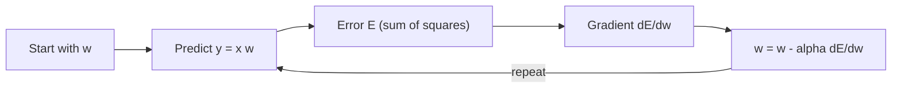

**In simple words:** hum model $y = xw$ ke saare $N$ pairs ke squared errors jodte hain, us total error ka $w$ ke respect mein slope nikalte hain, aur $w$ ko slope ke ulta chhota step move karte hain. <Cite id="class-dl-chp2" loc="slide 63" />

<Sum>

<Given>

$N$ pairs $(x_n, y_n)$, prediction $x_n w$, learning rate $\alpha$.

</Given>

<Find>

$E$, $\partial E / \partial w$ aur update rule.

</Find>

<Steps>

1. **Ek pair ka error:** $y_n - x_n w$. Use square karo taaki positive aur negative errors cancel na ho aur saare pairs par jodo. $\tfrac{1}{2}$ ek convention hai jo differentiate karte waqt 2 ko cancel kar deta hai: $E = \dfrac{1}{2}\sum_{n=1}^{N} (y_n - x_n w)^2$.
2. **Differentiate (chain rule):** square $2(y_n - x_n w)$ deta hai aur andar ka part $-x_n$, to $\dfrac{\partial E}{\partial w} = -\sum_{n=1}^{N} (y_n - x_n w)\, x_n$.
3. **Slope ke ulta step** (class ka rule $W_{new} = W_{old} - \eta\, \partial L / \partial W$): $w \leftarrow w - \alpha \dfrac{\partial E}{\partial w} = w + \alpha \sum_{n=1}^{N} (y_n - x_n w)\, x_n$.
4. **Chhota example:** pairs $(1, 2)$ aur $(2, 4)$, $w = 0$, $\alpha = 0.1$. Errors 2 aur 4, to $E = \tfrac{1}{2}(4 + 16) = 10$. Gradient $= -(2 \times 1 + 4 \times 2) = -10$. Naya $w = 0 - 0.1 \times (-10) = 1$. Naye errors 1 aur 2, to $E = \tfrac{1}{2}(1 + 4) = 2.5$.

</Steps>

<Answer>

$E = \dfrac{1}{2}\sum (y_n - x_n w)^2$ aur $w \leftarrow w + \alpha \sum (y_n - x_n w)\, x_n$. Example mein ek step $w$ ko 0 se 1 aur $E$ ko 10 se 2.5 par le jaata hai.

</Answer>

<Box kind="verify">

Example ke liye $E$ expand karo: $E = \tfrac{1}{2}[(2 - w)^2 + (4 - 2w)^2] = 10 - 10w + 2.5w^2$. Uska slope $-10 + 5w$ hai, jo $w = 0$ par $-10$ hai (step 4 se match) aur $w = 2$ par zero, jo sahi value hai kyunki $y = 2x$. Ye bhi $E(1) = 10 - 10 + 2.5 = 2.5$.

</Box>

</Sum>

**Note:** class files update rule $W_{new} = W_{old} - \eta\, \partial L / \partial W$ deti hain par $E$ ki derivation nahi; steps 1 aur 2 standard calculus hain.

**Conclusion:** predictions bahut chhoti hon to $w$ badhta hai aur bahut badi hon to ghatta hai, jab tak error sabse chhota na ho.
