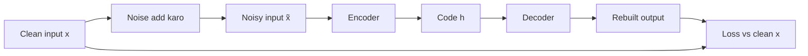

**In simple words:** denoising autoencoder (DAE) ko input ki ek kharab (damaged) copy di jaati hai aur use clean original wapas banana sikhaya jaata hai, jaise ek student jo smudged page ko sahi se dobara likh deta hai kyunki use language aati hai.

**Definition.** DAE ek autoencoder hai (encoder jo input ko ek code mein compress karta hai, aur decoder jo use wapas banata hai) jiska input jaan-boojh ke corrupt kiya jaata hai jabki target clean rehta hai. <Cite id="vincent2008" />

**Ye kyun zaroori hai.** Normal autoencoder jiska code bada ho, wo bas input ko copy kar sakta hai aur kuch nahi seekhta. Noisy input aur clean target ke saath copy karna punish hota hai, to use data ka real structure seekhna padta hai. <Cite id="gfdl-ch14" loc="§14.2.2" />

**Model kaise kaam karta hai**

1. Ek clean input $x$ lo.
2. Use corrupt karke $\tilde{x}$ banao: random values ko 0 kar do (masking noise) ya thoda Gaussian noise add karo.
3. Encoder $\tilde{x}$ ko code mein badalta hai; decoder output wapas banata hai.
4. Loss output ko **clean** $x$ se compare karta hai, noisy input se nahi.
5. Backpropagate karo, weights update karo, aur agle pass ke liye fresh noise lo.

**Advantages:** robust features seekhta hai; pure copy seekhne se rokta hai. **Limitation:** noise ka type aur amount sahi choose karna padta hai.

**Applications:** images aur audio se noise hatana, robust feature learning, deep networks ki pretraining. <Cite id="gfg-denoising-autoencoder" />

**Conclusion:** noise ko undo karna seekh ke, DAE ye seekhta hai ki real data kaisa dikhta hai, sirf copy karne ki jagah.

Exam mein English mein likho: "A denoising autoencoder is trained to reconstruct the clean input from a corrupted copy, so it learns robust features instead of the identity function."
