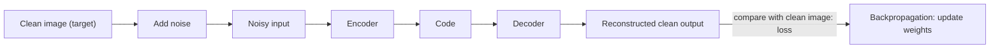

**In simple words:** denoising autoencoder ko damaged (noisy) input diya jaata hai aur use original clean input wapas dene ke liye train kiya jaata hai, to wo noise phenkna seekhta hai. <Cite id="class-dl-chp3" loc="slide 23" />

**Definition:** a Denoising Autoencoder (DAE) is an autoencoder that receives a noisy input but is trained to reconstruct the original clean input. Main idea: Noisy Input → Autoencoder → Clean Output. <Cite id="class-dl-chp3" loc="slide 23" />

**Ye kyun zaroori hai:** real-world data noisy ya corrupted hota hai. Normal autoencoder jo bhi diya jaaye use copy karna seekh sakta hai, noise samet. <Cite id="class-dl-chp3" loc="slide 23" />

**Training:** clean image mein noise add karo, encoder ko do, decoder reconstruct kare, **clean target** se compare karo (MSE ya MAE), phir backpropagate karke weights update karo. Noise ke types: Gaussian, salt-and-pepper, masking, speckle. <Cite id="class-dl-chp3" loc="slide 24" />

**Key point:** Input (noisy) ≠ Target (clean). Model input simply copy nahi kar sakta, isliye use important underlying features seekhne padte hain, jisse overfitting bhi kam hoti hai. <Cite id="class-dl-chp3" loc="slide 24" /> Textbook kehta hai autoencoder ko dikhne wala input "is not the raw input but a stochastically corrupted version". <Cite id="class-dl-m3" loc="p. 26" />

**Applications:** image denoising, image restoration, medical image processing, speech denoising, watermarks hataana.

**Conclusion:** DAE = Denoise and Reconstruct Clean Data.

Exam mein English mein likho: "A denoising autoencoder takes a noisy input and is trained to reconstruct the original clean input."
