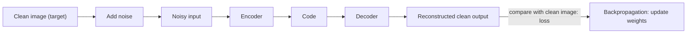

**In simple words:** a denoising autoencoder is given a damaged (noisy) input and trained to give back the original clean one, so it learns to throw the noise away. <Cite id="class-dl-chp3" loc="slide 23" />

**Definition:** a Denoising Autoencoder (DAE) is an autoencoder that receives a noisy input but is trained to reconstruct the original clean input. Main idea: Noisy Input → Autoencoder → Clean Output. <Cite id="class-dl-chp3" loc="slide 23" />

**Why it is needed:** real-world data is noisy or corrupted. A normal autoencoder may learn to copy whatever it is given, including the noise. <Cite id="class-dl-chp3" loc="slide 23" />

**Training:** add noise to a clean image, feed it to the encoder, let the decoder reconstruct, compare with the **clean target** (MSE or MAE), then backpropagate and update the weights. Types of noise: Gaussian, salt-and-pepper, masking, speckle. <Cite id="class-dl-chp3" loc="slide 24" />

**Key point:** Input (noisy) ≠ Target (clean). Because the model cannot just copy the input, it must learn the important underlying features, which also reduces overfitting. <Cite id="class-dl-chp3" loc="slide 24" /> The textbook says the input seen by the autoencoder "is not the raw input but a stochastically corrupted version". <Cite id="class-dl-m3" loc="p. 26" />

**Applications:** image denoising, image restoration, medical image processing, speech denoising, removing watermarks.

**Conclusion:** DAE = Denoise and Reconstruct Clean Data.
