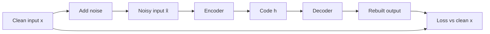

**In simple words:** a denoising autoencoder (DAE) is given a damaged copy of an input and is trained to rebuild the clean original, like a student who rewrites a smudged page correctly because they know the language.

**Definition.** A DAE is an autoencoder (an encoder that squeezes the input into a code, and a decoder that rebuilds it) whose input is deliberately corrupted while its target stays clean. <Cite id="vincent2008" />

**Why it is needed.** A normal autoencoder with a large code can simply copy its input and learn nothing. With a noisy input and a clean target, copying is punished, so it must learn the real structure of the data. <Cite id="gfdl-ch14" loc="§14.2.2" />

**How the model works**

1. Take a clean input $x$.
2. Corrupt it to $\tilde{x}$: set random values to 0 (masking noise) or add small Gaussian noise.
3. The encoder turns $\tilde{x}$ into a code; the decoder rebuilds an output.
4. The loss compares the output with the **clean** $x$, not with the noisy input.
5. Backpropagate, update the weights, and draw fresh noise for the next pass.

**Advantages:** learns robust features; is discouraged from learning a pure copy. **Limitation:** the noise type and amount must be chosen well.

**Applications:** removing noise from images and audio, robust feature learning, pretraining deep networks. <Cite id="gfg-denoising-autoencoder" />

**Conclusion:** by learning to undo noise, a DAE learns what real data looks like instead of merely copying it.
