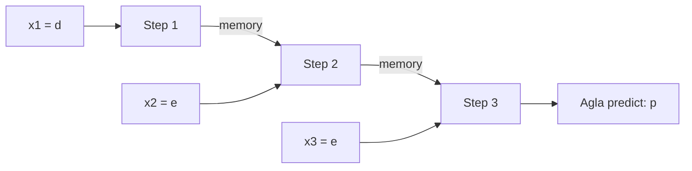

**In simple words:** sequence learning problem wo task hai jismein data ka order matter karta hai, jaise sentence mein words. Model linked inputs ko ek time step pe ek karke padhta hai aur ek output ya outputs ki series deta hai.

**Definition.** Sequence learning ka matlab hai aisi mapping seekhna jismein input, output, ya dono ordered sequences hon (text, speech, time series, video frames).

**Isko special model kyun chahiye.** Feedforward network ka input size fixed hota hai aur uske paas memory nahi hoti, par sequence problems ki teen properties hoti hain <Cite id="nptel-dl" />:

1. **Inputs ek dusre pe depend karte hain.** "d", "e" ke baad agla letter pichhle letters pe depend karta hai.
2. **Length fixed nahi hoti.** "deep" mein 4 letters hain, "learning" mein 8.
3. **Har step pe same task hota hai**, isliye har step pe same function use hona chahiye.

**Types, applications ke saath** <Cite id="karpathy-rnn" />

| Type | Application |
|---|---|
| One to many | Image captioning |
| Many to one | Movie review ka sentiment |
| Many to many | Machine translation; har word ke liye ek tag |

**Conclusion:** RNN teeno zaroorat poori karta hai: memory ke liye hidden state, kitne bhi steps, aur har step pe same weights. <Cite id="gfdl-ch10" loc="§10.2" /> <Cite id="gfg-rnn" />

Exam mein English mein likho: "In a sequence learning problem the inputs are dependent, of variable length, and the same task is done at every time step."
