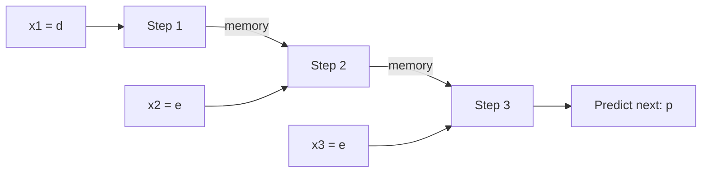

**In simple words:** a sequence learning problem is a task where the order of the data matters, like words in a sentence. The model reads linked inputs one time step at a time and gives one output or a series of outputs.

**Definition.** Sequence learning means learning a mapping where the input, the output, or both are ordered sequences (text, speech, time series, video frames).

**Why it needs a special model.** A feedforward network has a fixed input size and no memory, but sequence problems have three properties <Cite id="nptel-dl" />:

1. **Inputs depend on each other.** The next letter after "d", "e" depends on the earlier letters.
2. **Length is not fixed.** "deep" has 4 letters, "learning" has 8.
3. **The same task is done at every step**, so the same function should be used at each step.

**Types, with applications** <Cite id="karpathy-rnn" />

| Type | Application |
|---|---|
| One to many | Image captioning |
| Many to one | Sentiment of a movie review |
| Many to many | Machine translation; a tag for every word |

**Conclusion:** an RNN fits all three needs: a hidden state as memory, any number of steps, and the same weights at every step. <Cite id="gfdl-ch10" loc="§10.2" /> <Cite id="gfg-rnn" />
