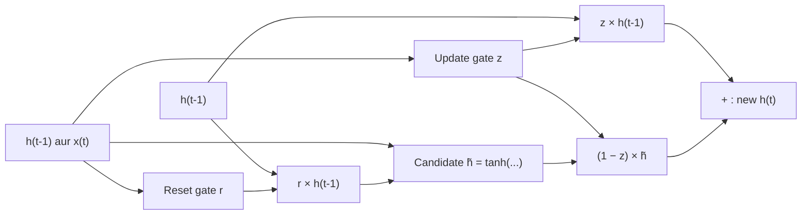

**In simple words:** Gated Recurrent Unit (GRU) ek improved RNN cell hai (Cho et al., 2014). Ye do gates se decide karta hai ki purani memory kitni rakhni hai aur nayi information kitni leni hai, isliye bahut saare time steps tak yaad rakh sakta hai. <Cite id="cho2014" />

**Definition.** GRU ek recurrent cell hai jisme update gate aur reset gate hote hain, jo control karte hain ki hidden state (cell ki memory) ek time step se agle tak kaise badle. Gate ek sigmoid layer (output 0 se 1) hai jo kisi value ka 0% se 100% tak aage jaane deti hai.

**Why it is needed.** Plain RNN har step pe apni poori memory dobara likh deta hai, aur gradient bahut steps peeche jaate hue chhota ho jaata hai, to door-door ke words ka link nahi seekh paata. Gates GRU ko useful memory rakhne dete hain (jaise student zaroori purane notes rakhta hai aur sirf naye points add karta hai).

**How it works, step by step**

1. Cell ko previous hidden state $h_{t-1}$ aur current input $x_t$ milte hain.
2. **Update gate** $z_t$: purani memory kitni rakhni hai; baaki, $1 - z_t$, nayi information se aata hai. Ye LSTM ke forget aur input gate dono ka kaam karta hai.
3. **Reset gate** $r_t$: candidate banate waqt purani memory kitni use karni hai. 0 ke paas matlab current input se fresh start.
4. **Candidate** $\tilde{h}_t$: tanh layer se ek proposed nayi memory.
5. **Blend**: update gate se purani state aur candidate ko mix karo.

**Equations** ($\sigma$ sigmoid hai, $\odot$ element-wise product) <Cite id="gfdl-ch10" loc="§10.10.2" /> <Cite id="d2l-gru" />

$$
z_t = \sigma(W_z [h_{t-1}, x_t] + b_z), \qquad r_t = \sigma(W_r [h_{t-1}, x_t] + b_r)
$$

$$
\tilde{h}_t = \tanh(W_h [r_t \odot h_{t-1}, x_t] + b_h), \qquad h_t = z_t \odot h_{t-1} + (1 - z_t) \odot \tilde{h}_t
$$

Jab $z_t$ 1 ke paas ho, purani memory almost bina badle aage copy ho jaati hai, to gradient bahut steps peeche tak bina chhota hue pahunch sakta hai.

**Advantages:** sirf do gates aur alag cell state nahi, to LSTM se lagbhag 25% kam parameters; train karna fast, aur accuracy aksar similar <Cite id="chung2014" />. **Disadvantage:** LSTM jitna fine control nahi (output gate nahi).

**Conclusion:** GRU ek simple aur fast gated RNN hai jo update gate aur reset gate ki madad se long-term memory rakhta hai (speech recognition aur translation mein use hota hai). <Cite id="gfg-gru" />

Exam mein English mein likho: "GRU uses an update gate and a reset gate to control how much past information is kept, which solves the vanishing gradient problem of simple RNNs."
