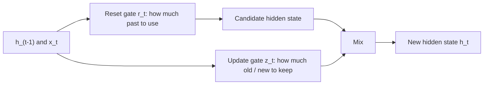

**In simple words:** GRU LSTM ka simpler cousin hai. Ye do gates se tay karta hai ki past ka kitna use karna hai aur nayi information ka kitna rakhna hai, aur memory sirf hidden state mein rakhta hai.

**Definition:** GRU (Gated Recurrent Unit) RNN ka ek aur type hai jo information control karne aur long-term dependencies handle karne ke liye gates use karta hai. GRUs RNNs ka modified form hain, bahut lambi range ki dependencies pakadne mein bahut effective, aur vanishing gradient problem mein madad karte hain. <Cite id="class-dl-chp5" loc="slide 20" /> <Cite id="class-dl-m5" loc="p. 27" />

**Idea:** LSTM ke teen gates ki jagah do hain, **reset gate** aur **update gate**, dono sigmoid ke saath, isliye values 0 aur 1 ke beech. **Alag cell state nahi** hota; hidden state hi memory hai. <Cite id="class-dl-m5" loc="p. 28" />

**Equations** (update gate $z$ = purane state ka rakha hua hissa): <Cite id="class-dl-m5" loc="p. 26" />

$r_t = \sigma(W_r[x_t, h_{t-1}] + b_r)$, $z_t = \sigma(W_z[x_t, h_{t-1}] + b_z)$, $\tilde{h}_t = \tanh(W_h[x_t, r_t \odot h_{t-1}] + b_h)$, $h_t = z_t \odot h_{t-1} + (1 - z_t) \odot \tilde{h}_t$.

**Example:** $h_{t-1} = 10$, candidate $= 4$, $z = 0.7$ se $h_t = 0.7 \times 10 + 0.3 \times 4 = 8.2$. <Cite id="class-dl-chp5" loc="slide 21" />

**Gates ka use:** reset gate short-term dependencies pakadne mein aur update gate long-term dependencies pakadne mein madad karta hai. <Cite id="class-dl-m5" loc="p. 30" />

**Advantages:** LSTM se simpler architecture aur kam parameters, isliye bade models ban sakte hain. **Applications:** text generation, translation, speech recognition, time series. <Cite id="class-dl-m5" loc="p. 31" />

**Conclusion:** GRU = do gates, cell state nahi, LSTM se kam cost mein long-term memory.
