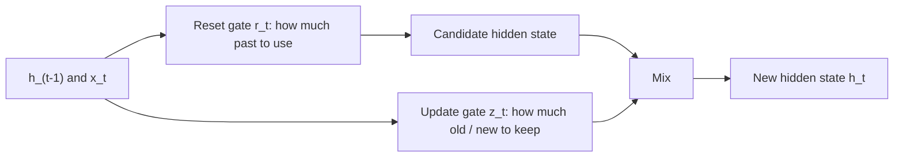

**In simple words:** a GRU is a simpler cousin of the LSTM. It uses two gates to decide how much of the past to use and how much of the new information to keep, and it keeps its memory only in the hidden state.

**Definition:** GRU (Gated Recurrent Unit) is another type of RNN that uses gates to control information and handle long-term dependencies. GRUs are a modified form of RNNs, highly effective at capturing much longer range dependencies, and they help with the vanishing gradient problem. <Cite id="class-dl-chp5" loc="slide 20" /> <Cite id="class-dl-m5" loc="p. 27" />

**Idea:** the LSTM's three gates are replaced by two, the **reset gate** and the **update gate**, both with sigmoid so their values lie between 0 and 1. There is **no separate cell state**; the hidden state is the memory. <Cite id="class-dl-m5" loc="p. 28" />

**Equations** (update gate $z$ = share of the old state kept): <Cite id="class-dl-m5" loc="p. 26" />

$r_t = \sigma(W_r[x_t, h_{t-1}] + b_r)$, $z_t = \sigma(W_z[x_t, h_{t-1}] + b_z)$, $\tilde{h}_t = \tanh(W_h[x_t, r_t \odot h_{t-1}] + b_h)$, $h_t = z_t \odot h_{t-1} + (1 - z_t) \odot \tilde{h}_t$.

**Example:** $h_{t-1} = 10$, candidate $= 4$, $z = 0.7$ gives $h_t = 0.7 \times 10 + 0.3 \times 4 = 8.2$. <Cite id="class-dl-chp5" loc="slide 21" />

**Use of the gates:** the reset gate helps capture short-term dependencies and the update gate helps capture long-term dependencies. <Cite id="class-dl-m5" loc="p. 30" />

**Advantages:** simpler architecture and fewer parameters than LSTM, so bigger models can be built. **Applications:** text generation, translation, speech recognition, time series. <Cite id="class-dl-m5" loc="p. 31" />

**Conclusion:** GRU = two gates, no cell state, long-term memory with less cost than LSTM.
