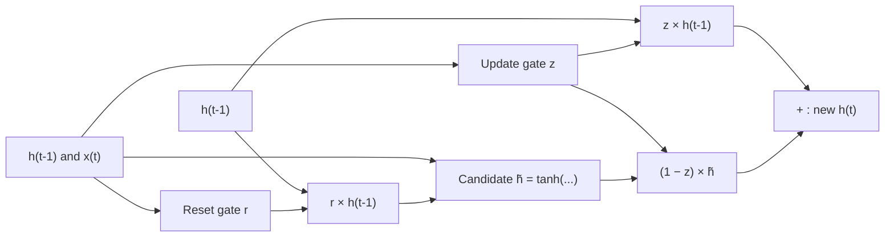

**In simple words:** a Gated Recurrent Unit (GRU) is an improved RNN cell (Cho et al., 2014). It uses two gates to decide how much old memory to keep and how much new information to take in, so it can remember over many time steps. <Cite id="cho2014" />

**Definition.** A GRU is a recurrent cell with an update gate and a reset gate that control how its hidden state (its memory) changes from one time step to the next. A gate is a sigmoid layer (output 0 to 1) that lets 0% to 100% of a value through.

**Why it is needed.** A plain RNN rewrites its whole memory at every step, and the gradient shrinks as it travels back through many steps, so it cannot learn links between far-apart words. Gates let the GRU keep useful memory (like a student who keeps important old notes and adds only new points).

**How it works, step by step**

1. The cell receives the previous hidden state $h_{t-1}$ and the current input $x_t$.
2. **Update gate** $z_t$: how much old memory to keep; the rest, $1 - z_t$, comes from new information. It does the work of the LSTM's forget and input gates together.
3. **Reset gate** $r_t$: how much old memory to use when building the candidate. Near 0 means a fresh start from the current input.
4. **Candidate** $\tilde{h}_t$: a proposed new memory from a tanh layer.
5. **Blend** the old state and the candidate using the update gate.

**Equations** ($\sigma$ is the sigmoid, $\odot$ the element-wise product) <Cite id="gfdl-ch10" loc="§10.10.2" /> <Cite id="d2l-gru" />

$$
z_t = \sigma(W_z [h_{t-1}, x_t] + b_z), \qquad r_t = \sigma(W_r [h_{t-1}, x_t] + b_r)
$$

$$
\tilde{h}_t = \tanh(W_h [r_t \odot h_{t-1}, x_t] + b_h), \qquad h_t = z_t \odot h_{t-1} + (1 - z_t) \odot \tilde{h}_t
$$

When $z_t$ is near 1, the old memory is copied forward almost unchanged, so the gradient can pass back through many steps without shrinking.

**Advantages:** only two gates and no separate cell state, so about 25% fewer parameters than an LSTM; faster to train, and often similar accuracy <Cite id="chung2014" />. **Disadvantage:** less fine control than an LSTM (no output gate).

**Conclusion:** the GRU is a simpler, faster gated RNN that keeps long-term memory with an update gate and a reset gate (used in speech recognition and translation). <Cite id="gfg-gru" />
