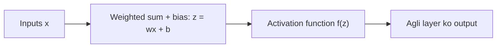

**In simple words:** activation function neuron ka output decide karta hai aur network ko complex patterns seekhne mein help karta hai. <Cite id="class-dl-chp2" loc="slide 9" />

**Definition:** activation function ek mathematical function hai jo neural network mein ye decide karne ke liye use hota hai ki neuron activate ho (information pass kare) ya nahi. Ye neuron ka output ($z = wx + b$) leta hai aur use naye value mein badalta hai jo agli layer ko jaata hai. Iske bina network simple linear model ki tarah behave karta hai; iske saath network non-linear, complex patterns seekh sakta hai. <Cite id="class-dl-chp2" loc="slide 9" /> <Cite id="class-dl-m2" loc="p. 3" />

**Chaar activation functions**

1. **Sigmoid:** $\sigma(x) = \dfrac{1}{1 + e^{-x}}$. S-shaped, range **0 se 1**, probability deta hai. Binary classification ki output layer mein use hota hai. Vanishing gradient problem ho sakti hai. <Cite id="class-dl-chp2" loc="slide 11" />
2. **Tanh:** $\tanh(x) = \dfrac{e^x - e^{-x}}{e^x + e^{-x}}$. S-shaped, range **−1 se +1**, zero-centered. Hidden layers mein use hota hai. <Cite id="class-dl-chp2" loc="slide 13" />
3. **ReLU:** $\max(0, x)$. Range **[0, ∞)**; negative inputs 0 ho jaate hain. Simple, fast, hidden layers mein sabse zyada use; dying ReLU problem ho sakti hai. <Cite id="class-dl-chp2" loc="slide 15" />
4. **Leaky ReLU:** $x > 0$ ke liye $x$ aur $x \le 0$ ke liye $0.01x$. Range **(−∞, ∞)**. Ye chhota negative value pass hone deta hai, isliye dying ReLU problem solve karta hai. <Cite id="class-dl-chp2" loc="slide 17" />

**Conclusion:** activation functions non-linearity jodte hain; sigmoid binary output ke liye, tanh aur ReLU hidden layers ke liye, aur leaky ReLU dying ReLU problem fix karne ke liye.
