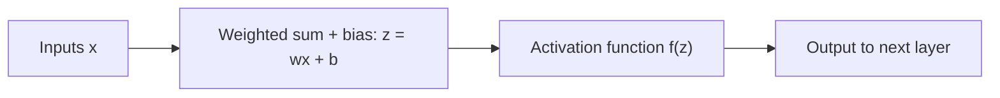

**In simple words:** an activation function decides the output of a neuron and helps the network learn complex patterns. <Cite id="class-dl-chp2" loc="slide 9" />

**Definition:** an activation function is a mathematical function used in a neural network to decide whether a neuron should be activated (pass information) or not. It takes the output of a neuron ($z = wx + b$) and converts it into a new value that goes to the next layer. Without it the network behaves like a simple linear model; with it the network can learn non-linear, complex patterns. <Cite id="class-dl-chp2" loc="slide 9" /> <Cite id="class-dl-m2" loc="p. 3" />

**Four activation functions**

1. **Sigmoid:** $\sigma(x) = \dfrac{1}{1 + e^{-x}}$. S-shaped, range **0 to 1**, gives a probability. Used in the output layer for binary classification. Can suffer from the vanishing gradient problem. <Cite id="class-dl-chp2" loc="slide 11" />
2. **Tanh:** $\tanh(x) = \dfrac{e^x - e^{-x}}{e^x + e^{-x}}$. S-shaped, range **−1 to +1**, zero-centered. Used in hidden layers. <Cite id="class-dl-chp2" loc="slide 13" />
3. **ReLU:** $\max(0, x)$. Range **[0, ∞)**; negative inputs become 0. Simple, fast, the most used in hidden layers; the dying ReLU problem can occur. <Cite id="class-dl-chp2" loc="slide 15" />
4. **Leaky ReLU:** $x$ for $x > 0$ and $0.01x$ for $x \le 0$. Range **(−∞, ∞)**. It solves the dying ReLU problem by letting a small negative value pass. <Cite id="class-dl-chp2" loc="slide 17" />

**Conclusion:** activation functions add non-linearity; sigmoid suits binary output, tanh and ReLU suit hidden layers, and leaky ReLU fixes the dying ReLU problem.
