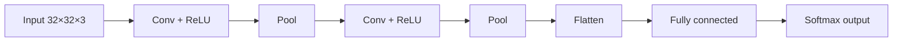

**In simple words:** convolutional neural network (CNN) image ko ek time pe ek chhote patch mein dekhta hai. Chhote learned filters image pe slide karke edges jaise patterns dhoondhte hain, pooling result ko chhota karti hai, aur fully connected layers final decision leti hain.

**Why it is needed.** Ek 32×32×3 image pe bhi fully connected layer har neuron ke liye 3072 weights leti hai, ye nahi dekhti ki kaun se pixels paas-paas hain, aur har position pe ek hi pattern dobara seekhna padta hai. CNN in teeno problems ko solve karta hai.

**Architecture, layer by layer**

1. **Input layer:** image height × width × channels ke roop mein, jaise $32 \times 32 \times 3$.
2. **Convolutional layer:** filters chuni hui stride aur padding ke saath input pe slide karte hain. Har position pe filter sabhi input channels pe multiply aur add karke ek number deta hai; ek filter ek feature map deta hai. Wahi filter har jagah reuse hota hai (**weight sharing**) aur har output sirf ek chhota patch dekhta hai (**local connectivity**).
3. **ReLU:** negative values ko 0 bana deta hai, non-linearity add karne ke liye.
4. **Pooling layer:** chhote blocks (usually 2×2, stride 2) ka max ya average; height aur width aadhi karti hai, channels same rakhti hai, aur iske koi parameters nahi hote.
5. **Repeat** conv → ReLU → pool: shuruaati layers edges dhoondhti hain, gehri layers shapes aur object ke parts.
6. **Flatten aur fully connected layers**, phir **softmax output layer** jo har class ke liye ek probability deti hai.

**Advantages:** kam parameters, features khud seekhta hai, image mein kahin bhi pattern dhoondh leta hai. **Limitation:** bahut labelled data aur GPU time chahiye. <Cite id="gfdl-ch9" /> <Cite id="gfg-cnn" />

**Numerical: is convolutional layer ke parameters.**

Given: input $32 \times 32 \times 3$, das $5 \times 5$ filters, stride $S = 1$, padding $P = 2$.

To find: is layer ke parameters ki sankhya.

1. **Ek filter ke weights:** $5 \times 5 \times 3 = 75$, kyunki har filter sabhi 3 input channels ko cover karta hai.
2. **Ek bias add karo:** $75 + 1 = 76$.
3. **Das filters se multiply karo:** $76 \times 10 = 760$. Wahi numbers sabhi positions pe reuse hote hain, to positions parameters nahi badhate.
4. **Output size:** $(32 - 5 + 2 \times 2)/1 + 1 = 32$, to output $32 \times 32 \times 10$ hai. Padding size same rakhti hai aur parameters nahi badhati.

**Answer: 760 parameters** (750 weights + 10 biases).

<Box kind="verify">

Dusre tarike se ginte hain: 10 filters × 75 weights = 750, plus 10 biases = 760. Scale ke liye, isi 32×32×10 output ke liye fully connected layer ko $3072 \times 10240 = 31{,}457{,}280$ weights chahiye (lagbhag 31.5 million), to weight sharing bahut bachata hai.

</Box>

**Conclusion:** local connections aur weight sharing se CNN bahut kam parameters (yahan sirf 760) mein image features seekh leta hai.

Exam mein English mein likho: "A convolutional layer has (F × F × C_in + 1) × K parameters, because each filter spans all input channels, has one bias, and is reused at every position."
