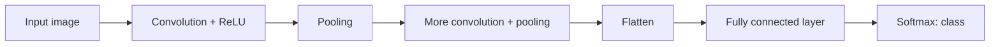

**In simple words:** CNN ek deep learning model hai jo sliding filters se images ke features seekhta hai. Convolution aur pooling layers features dhundti hain; flatten aur fully connected layers class decide karti hain.

**Definition:** CNN ek type ka deep neural network hai jo specially images aur dusre grid-like data ke liye bana hai. <Cite id="class-dl-chp4" loc="slide 5" />

**Kyun zaroori:** fully connected network mein parameters bahut zyada ho jaate hain (28×28 pixels aur 100 neurons ko 78,400 weights chahiye) aur spatial information kho jaati hai. CNN local connectivity, weight sharing aur pooling use karta hai. <Cite id="class-dl-chp4" loc="slide 5" />

**Layers** <Cite id="class-dl-chp4" loc="slide 28" />

1. **Convolution + ReLU:** filters input par slide karte hain, multiply aur add karte hain, har filter ek feature map deta hai. Output size $\lfloor (N - F + 2P)/S \rfloor + 1$, depth = filters ki sankhya.
2. **Pooling:** height aur width kam karta hai, depth nahi.
3. **Flatten + fully connected + softmax:** features vector ban jaate hain aur class probabilities mein badalte hain.

**Convolution layer ke parameters** $= (F \times F \times D + 1) \times K$. <Cite id="class-dl-chp4" loc="slide 27" />

<Sum>

<Given>

input volume 32×32×3, das 5×5 filters, stride 1, padding 2.

</Given>

<Find>

parameters ki sankhya (aur output size).

</Find>

<Steps>

1. **Har filter 5×5×3 hai,** kyunki uski depth input depth (3) ke barabar honi chahiye.
2. **Har filter ke weights:** $5 \times 5 \times 3 = 75$.
3. **Har filter ka ek bias jodo:** $75 + 1 = 76$.
4. **Saare das filters:** $76 \times 10 = 760$.
5. **Output size:** $(32 - 5 + 2 \cdot 2)/1 + 1 = 32$, depth 10, to 32×32×10. Stride aur padding se parameter count nahi badalta.

</Steps>

<Answer>

760 parameters (output 32×32×10).

</Answer>

<Box kind="verify">

Formula: $(5 \cdot 5 \cdot 3 + 1) \times 10 = 76 \times 10 = 760$. 5×5 filter ke saath padding 2 "same" padding hai ($P = (F-1)/2 = 2$), isliye 32×32 hi rehta hai.

</Box>

</Sum>

**Conclusion:** CNN shared filters se features seekhta hai, isliye image kitni bhi badi ho is layer ko sirf 760 parameters chahiye.
