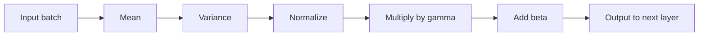

**In simple words:** early stopping sahi time par training rok deta hai, batch normalization har layer ki values ko similar range mein rakhta hai, aur data augmentation purane samples se naye training samples banata hai. Teeno network ko better train aur generalize karne mein help karte hain. <Cite id="class-dl-chp2" loc="slides 109, 113 and 115" />

**1. Early stopping.** Agar training bahut zyada epochs chale to model training data ratta maarne lagta hai: validation accuracy ghatti hai. Early stopping tab training automatically rok deta hai jab model validation data par improve hona band kar de, aur best model save ho jaata hai. **Patience** wo epochs ki sankhya hai jitna intezaar karna hai (patience 3: 3 epochs bina improvement ke baad stop). Example: epoch 4 par validation loss 0.48, phir 0.49, 0.50, 0.51 epoch 7 par rukta hai aur epoch 4 rakhta hai. <Cite id="class-dl-chp2" loc="slides 113 and 114" />

**2. Batch normalization.** Weights badalne se har layer ke inputs badalte rehte hain (internal covariate shift) aur training slow ho jaati hai. Batch normalization agli layer se pehle ek layer ke outputs normalize karta hai: batch ka mean $\mu$ aur variance $\sigma^2$ calculate karo, normalize $\hat x = \dfrac{x - \mu}{\sqrt{\sigma^2 + \epsilon}}$, phir scale aur shift $y = \gamma \hat x + \beta$ ($\gamma$, $\beta$ seekhe jaate hain). Isse training faster aur stable hoti hai aur higher learning rate allow hota hai. <Cite id="class-dl-chp2" loc="slides 109 and 110" />

**3. Data augmentation.** Chhota dataset overfitting karata hai aur zyada data collect karna costly hai. Data augmentation existing data ko modify karke naye training samples banata hai (rotation, flipping, zooming, cropping, brightness, noise); label nahi badalta, to flipped apple ab bhi Apple hai. <Cite id="class-dl-chp2" loc="slides 115 and 116" />

| | Early stopping | Batch normalization | Data augmentation |
|---|---|---|---|
| Kis par kaam karta hai | Training duration | Layer outputs | Training data |
| Main benefit | Overfitting rokta hai | Faster, stable training | Zyada data, kam overfitting |

**Conclusion:** teeno methods teen alag problems fix karte hain: bahut lambi training, layers ke unstable inputs, aur kam data.

Exam mein English mein likho: "Batch normalization normalizes the outputs of a layer: y = gamma x-hat + beta."
