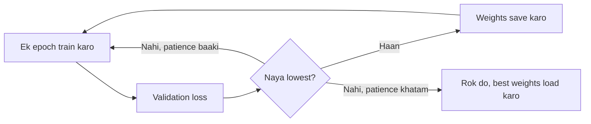

**In simple words:** teeno cheezein deep network ko achhe se train hone aur naye data pe kaam karne mein madad karti hain. Early stopping training ko sahi waqt pe rokti hai, batch normalization har layer ke inputs ka size steady rakhti hai, aur data augmentation extra training examples banata hai.

**1. Early stopping**

*Definition.* Training tab tak hi karo jab tak validation data pe error girta rahe; jab sudhar ruk jaaye to rok do. <Cite id="gfdl-ch7" loc="§7.8" />

*Why needed.* Training error girta rahta hai, lekin validation error ek lowest point tak girta hai aur phir badhne lagta hai, kyunki network ratta marna shuru kar deta hai.

*How it works.*

1. Har epoch ke baad validation loss napo.
2. Jab bhi wo naya lowest value chhue, weights save karo.
3. Agar fixed number of epochs (*patience*) tak sudhar na ho, to rok do aur saved weights wapas load karo.

*Advantages:* network ya loss mein badlaav nahi, time bachta hai. *Limitation:* validation set chahiye; noisy curve pe jaldi ruk sakta hai. *Use:* Keras EarlyStopping callback. <Cite id="gfg-early-stopping" />

**2. Batch normalization**

*Definition.* Ek layer jo mini-batch mein ek unit ki values ko average 0 aur spread 1 tak rescale karti hai, phir ek learned scale $\gamma$ aur shift $\beta$ lagati hai. <Cite id="ioffe2015" />

*Why needed.* Jaise pehle wali layers badalti hain, later layers tak pahunchne wali values ka size badalta rehta hai, to training slow aur unstable ho jaati hai.

*How it works.* Batch ka average $\mu_B$ aur variance $\sigma_B^2$ nikaalo, average ghatao, variance ke square root se bhaag do ($\epsilon$ ek bahut chhota number hai taaki zero se bhaag na ho), phir scale aur shift karo:

$$
\hat{x}_i = \frac{x_i-\mu_B}{\sqrt{\sigma_B^2+\epsilon}},
\qquad
y_i = \gamma\hat{x}_i + \beta
$$

Test time pe training ke dauran save kiye hue $\mu$ aur $\sigma^2$ ke running averages use hote hain.

*Advantages:* training tez aur steady, higher learning rate, starting weights pe kam nirbharta, batch ke noise se halka regularization. *Limitation:* bahut chhote batches pe kamzor. *Use:* ResNet mein convolutions ke baad. <Cite id="gfdl-ch8" loc="§8.7.1" /> <Cite id="gfg-batchnorm" />

**3. Data augmentation**

*Definition.* Existing examples ko aise badalkar extra training examples banana jisse label na badle. <Cite id="gfdl-ch7" loc="§7.4" />

*Why needed.* Overfitting ke sabse achhe ilaajon mein se ek zyada data hai, lekin labelled data mehenga padta hai.

*Types.* Images: flip, crop, halka rotation, zoom, brightness change. Audio: noise add karna. Text: synonym replace karna.

*Advantages:* sasta extra data, position aur lighting ke liye robustness. *Limitation:* badlaav label nahi badalna chahiye; 6 ko 180° ghumaoge to 9 ban jaayega. *Use:* image classification aur medical imaging. <Cite id="gfg-data-augmentation" />

**Conclusion:** early stopping control karta hai *kab* rokna hai, batch normalization control karta hai *layers kaise* train hon, aur augmentation control karta hai *network kaunsa data* dekhe; teeno milkar overfitting kam karte hain.

Exam mein English mein likho: "Early stopping stops training when validation error starts rising, batch normalization normalizes layer inputs over each mini-batch, and data augmentation creates extra training samples by label-preserving transformations."
