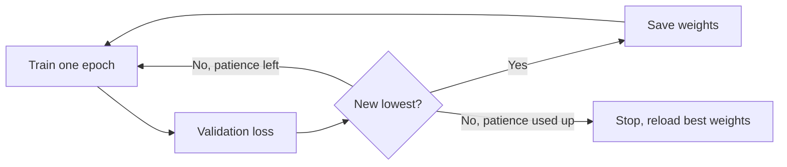

**In simple words:** all three help a deep network train well and work on new data. Early stopping stops training at the right moment, batch normalization keeps each layer's inputs at a steady size, and data augmentation makes extra training examples.

**1. Early stopping**

*Definition.* Train only while the error on validation data keeps falling, and stop when it stops improving. <Cite id="gfdl-ch7" loc="§7.8" />

*Why needed.* Training error keeps falling, but validation error falls, reaches a lowest point and then rises as the network starts to memorize.

*How it works.*

1. After every epoch, measure the validation loss.
2. Whenever it hits a new lowest value, save the weights.
3. If it does not improve for a fixed number of epochs (the *patience*), stop and reload the saved weights.

*Advantages:* no change to the network or loss, saves time. *Limitation:* needs a validation set; a noisy curve can stop too early. *Use:* the Keras EarlyStopping callback. <Cite id="gfg-early-stopping" />

**2. Batch normalization**

*Definition.* A layer that rescales a unit's values over each mini-batch to average 0 and spread 1, then applies a learned scale $\gamma$ and shift $\beta$. <Cite id="ioffe2015" />

*Why needed.* As earlier layers change, the values reaching later layers keep changing size, so training is slow and unstable.

*How it works.* Find the batch average $\mu_B$ and variance $\sigma_B^2$, subtract the average, divide by the square root of the variance ($\epsilon$ is a tiny number to avoid dividing by zero), then scale and shift:

$$
\hat{x}_i = \frac{x_i-\mu_B}{\sqrt{\sigma_B^2+\epsilon}},
\qquad
y_i = \gamma\hat{x}_i + \beta
$$

At test time, running averages of $\mu$ and $\sigma^2$ saved during training are used.

*Advantages:* faster, steadier training, higher learning rates, less sensitivity to starting weights, mild regularization from batch noise. *Limitation:* weak with very small batches. *Use:* after convolutions in ResNet. <Cite id="gfdl-ch8" loc="§8.7.1" /> <Cite id="gfg-batchnorm" />

**3. Data augmentation**

*Definition.* Create extra training examples by changing existing ones in ways that keep the label. <Cite id="gfdl-ch7" loc="§7.4" />

*Why needed.* More data is one of the best cures for overfitting, but labelled data is costly.

*Types.* Images: flip, crop, slight rotation, zoom, brightness change. Audio: added noise. Text: synonym replacement.

*Advantages:* cheap extra data, robustness to position and lighting. *Limitation:* the change must not alter the label; rotating a 6 by 180° makes a 9. *Use:* image classification and medical imaging. <Cite id="gfg-data-augmentation" />

**Conclusion:** early stopping controls *when* to stop, batch normalization controls *how* layers train, and augmentation controls *what* data the network sees; together they reduce overfitting.
