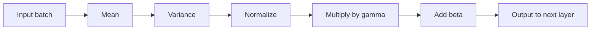

**In simple words:** early stopping stops training at the right time, batch normalization keeps each layer's values in a similar range, and data augmentation makes new training samples from old ones. All three help the network train better and generalize. <Cite id="class-dl-chp2" loc="slides 109, 113 and 115" />

**1. Early stopping.** If training runs for too many epochs, the model starts memorizing the training data: validation accuracy decreases. Early stopping automatically stops training when the model stops improving on the validation data, and the best model is saved. **Patience** is the number of epochs to wait (patience 3: stop after 3 epochs with no improvement). Example: validation loss 0.48 at epoch 4 and then 0.49, 0.50, 0.51 stops at epoch 7 and keeps epoch 4. <Cite id="class-dl-chp2" loc="slides 113 and 114" />

**2. Batch normalization.** As weights change, the inputs to each layer keep changing (internal covariate shift) and training becomes slow. Batch normalization normalizes the outputs of a layer before the next layer: calculate the mean $\mu$ and variance $\sigma^2$ of the batch, normalize $\hat x = \dfrac{x - \mu}{\sqrt{\sigma^2 + \epsilon}}$, then scale and shift $y = \gamma \hat x + \beta$ ($\gamma$, $\beta$ are learned). It makes training faster and more stable and allows a higher learning rate. <Cite id="class-dl-chp2" loc="slides 109 and 110" />

**3. Data augmentation.** A small dataset causes overfitting and collecting more data is costly. Data augmentation creates new training samples by modifying the existing data (rotation, flipping, zooming, cropping, brightness, noise); the label does not change, so a flipped apple is still an Apple. <Cite id="class-dl-chp2" loc="slides 115 and 116" />

| | Early stopping | Batch normalization | Data augmentation |
|---|---|---|---|
| Acts on | Training duration | Layer outputs | Training data |
| Main benefit | Prevents overfitting | Faster, stable training | More data, less overfitting |

**Conclusion:** the three methods fix three different problems: too long training, unstable inputs to layers, and too little data.
