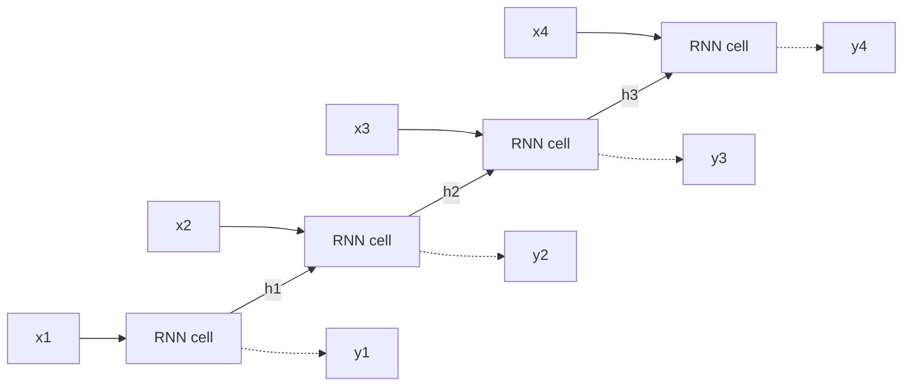

**In simple words:** RNN sequence ko ek-ek step mein padhta hai aur jo padha uski memory (hidden state) rakhta hai, taaki current input handle karte waqt pehle ke inputs use kar sake.

**Definition:** RNN ek type ka neural network hai jisme hidden states hote hain aur jo pichhle outputs ko inputs ki tarah use karne deta hai. <Cite id="class-dl-m5" loc="p. 9" />

**Ye kyun zaroori hai:** feedforward network ke paas pichhle inputs ki memory nahi hoti aur sequence ke har element ke liye alag parameters chahiye. RNN **har time step par same weights** use karta hai, isliye parameters kam hote hain aur wo kisi bhi length ki sequence handle karta hai. <Cite id="class-dl-m5" loc="p. 7" /> <Cite id="class-dl-m5" loc="p. 8" />

**Working, step by step** <Cite id="class-dl-chp5" loc="slide 7" />

1. Current input $x_t$ aur previous hidden state $h_{t-1}$ lo.
2. Cell dono ko combine karke new hidden state $h_t = \tanh(U x_t + W h_{t-1} + b)$ aur output $\hat{y}_t = \text{softmax}(V h_t + c)$ deta hai.
3. Sequence ke har element ke liye repeat karo. $U, W, V, b, c$ har step par same rehte hain.

**Types:** one to one, one to many (image captioning), many to one (sentiment analysis), many to many (machine translation). <Cite id="class-dl-m5" loc="p. 11" />

**Training:** backpropagation through time (BPTT): time mein aage, phir error time mein peeche, aur weights update. <Cite id="class-dl-chp5" loc="slide 10" />

**Limitations:** vanishing aur exploding gradients, isliye long-term dependencies seekhna mushkil. <Cite id="class-dl-chp5" loc="slide 12" />

**Applications:** speech recognition, music generation, translation, video analysis, DNA sequences. <Cite id="class-dl-m5" loc="p. 15" />

**Conclusion:** RNN = sequential data + previous information + hidden state.
