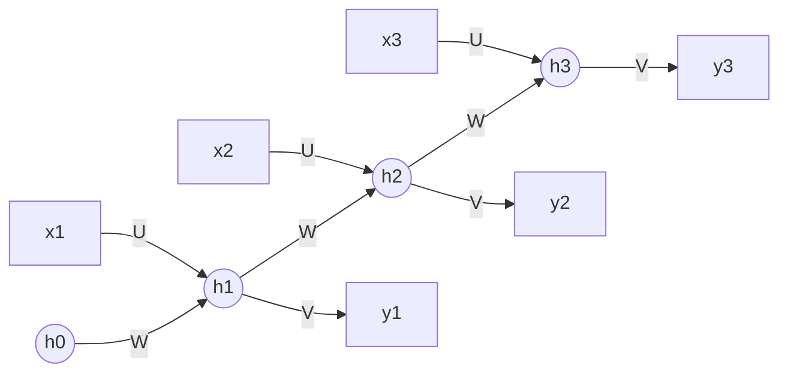

**In simple words:** recurrent neural network (RNN) ek aisa network hai jo order mein aane wale data ke liye bana hai, jaise sentence ke words. Ye ek time pe ek item padhta hai aur ek chalti hui memory rakhta hai, jise hidden state kehte hain. Ye memory har step se agle step ko pass hoti hai.

**Why it is needed.** Feedforward network ka input size fixed hota hai aur uske paas koi memory nahi hoti, isliye wo pehle ke words use karke baad ke words nahi samajh sakta. RNN ek loop add karta hai jo memory ko aage le jaata hai. Ye story padhne jaisa hai: har nayi line isliye samajh aati hai kyunki pichli lines yaad hain.

**Architecture: the layers**

- **Input layer** ($x_t$): time step $t$ pe sequence ka ek item, jaise ek word.
- **Hidden layer** ($h_t$): ye memory hai. Ye naya input input weights $U$ ke through leta hai aur apni pichli value recurrent weights $W$ ke through (yahi loop hai).
- **Output layer** ($\hat{y}_t$): is step ka answer, jo memory se output weights $V$ ke through banta hai.

**How it works, step by step**

1. Khaali memory se start karo ($h_0 = 0$).
2. Har step pe naye input ko pichli memory ke saath combine karo, bias add karo aur tanh lagao. Isse nayi memory milti hai.
3. Nayi memory se output banao (output agar class hai to softmax).
4. Sequence khatam hone tak **same** weights ke saath repeat karo.

Yahi steps ek formula mein <Cite id="gfdl-ch10" loc="§10.2" />:

$$
h_t = \tanh\left(W h_{t-1} + U x_t + b\right), \qquad \hat{y}_t = \text{softmax}\left(V h_t + c\right)
$$

jahan $b$ aur $c$ biases hain. Har step pe same $U$, $W$, $V$ use karna **parameter sharing** kehlata hai: network kisi bhi length ka input padh sakta hai, aur jo ek position pe seekha wo har position pe kaam karta hai.

**Unfolding.** Loop ko ek chain ki tarah draw karte hain, har time step ki ek copy:

**Types.** One-to-many (image captioning), many-to-one (sentiment analysis), many-to-many (translation, har word ko tag karna). **Bidirectional RNN** ek doosra RNN add karta hai jo ulta (backwards) padhta hai, taaki har output past aur future dono dekh sake. RNN layers ko **stack** karke deep RNN bhi bana sakte hain.

**Training.** Backpropagation through time (BPTT): chain ko unfold karo, saare steps ke losses jodo, error ko chain mein peeche bhejo, aur shared weights ke gradients saare steps pe jod do. <Cite id="d2l-rnn" />

**Advantages:** kisi bhi length ka input handle karta hai, sharing ki wajah se kam parameters, past ki memory rakhta hai.

**Disadvantages:** lambe sequences pe vanishing ya exploding gradients (isliye purane inputs bhool jaata hai), aur slow hai kyunki steps ek ke baad ek chalte hain. LSTM aur GRU memory wali problem fix karte hain.

**Applications:** text generation, speech recognition, machine translation, time-series forecasting. <Cite id="gfg-rnn" /> <Cite id="ibm-rnn" />

**Conclusion:** RNN ek loop wala network hai jo memory ko step se step aage le jaata hai, aur har time step pe same weights use karta hai.

Exam mein English mein likho: "An RNN is a network with a loop that carries memory from step to step, using the same weights at every time step."
