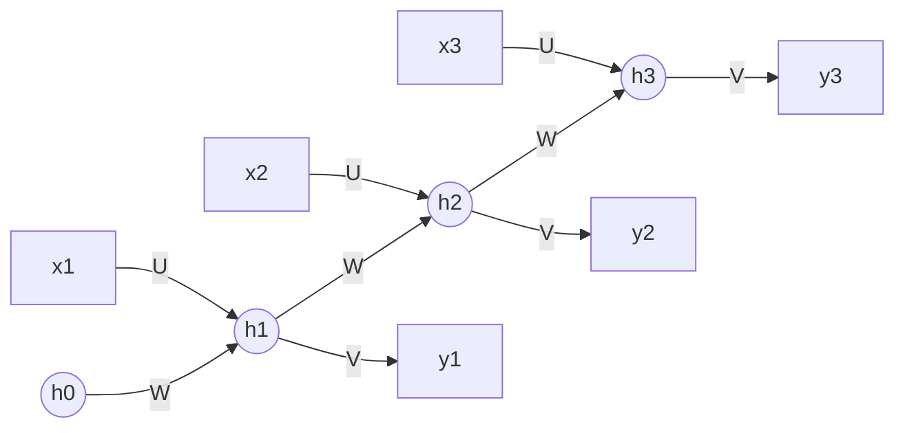

**In simple words:** a recurrent neural network (RNN) is a network for data that comes in order, like words in a sentence. It reads one item at a time and keeps a running memory, called the hidden state, which it passes from each step to the next.

**Why it is needed.** A feedforward network has a fixed input size and no memory, so it cannot use earlier words to understand later ones. An RNN adds a loop that carries memory forward. It is like reading a story: you understand each new line because you remember the earlier ones.

**Architecture: the layers**

- **Input layer** ($x_t$): one item of the sequence at time step $t$, for example one word.
- **Hidden layer** ($h_t$): the memory. It takes the new input through input weights $U$ and its own previous value through recurrent weights $W$ (the loop).
- **Output layer** ($\hat{y}_t$): the answer at this step, made from the memory through output weights $V$.

**How it works, step by step**

1. Start with an empty memory ($h_0 = 0$).
2. At each step, combine the new input with the previous memory, add a bias and apply tanh. This gives the new memory.
3. Make the output from the new memory (softmax when the output is a class).
4. Repeat with the **same** weights until the sequence ends.

The same steps as one formula <Cite id="gfdl-ch10" loc="§10.2" />:

$$
h_t = \tanh\left(W h_{t-1} + U x_t + b\right), \qquad \hat{y}_t = \text{softmax}\left(V h_t + c\right)
$$

where $b$ and $c$ are biases. Using the same $U$, $W$, $V$ at every step is **parameter sharing**: the network reads any length, and what it learns at one position works at all positions.

**Unfolding.** The loop is drawn as a chain with one copy per time step:

**Types.** One-to-many (image captioning), many-to-one (sentiment analysis), many-to-many (translation, tagging each word). A **bidirectional RNN** adds a second RNN reading backwards so each output sees past and future. RNN layers can also be **stacked** into a deep RNN.

**Training.** Backpropagation through time (BPTT): unfold the chain, add up the losses of all steps, send the error backwards along the chain, and add up the gradients of the shared weights over all steps. <Cite id="d2l-rnn" />

**Advantages:** handles any length, few parameters thanks to sharing, keeps a memory of the past.

**Disadvantages:** vanishing or exploding gradients over long sequences (so it forgets long-ago inputs), and slow because steps run one after another. LSTM and GRU fix the memory problem.

**Applications:** text generation, speech recognition, machine translation, time-series forecasting. <Cite id="gfg-rnn" /> <Cite id="ibm-rnn" />

**Conclusion:** an RNN is a network with a loop that carries memory from step to step, using the same weights at every time step.
