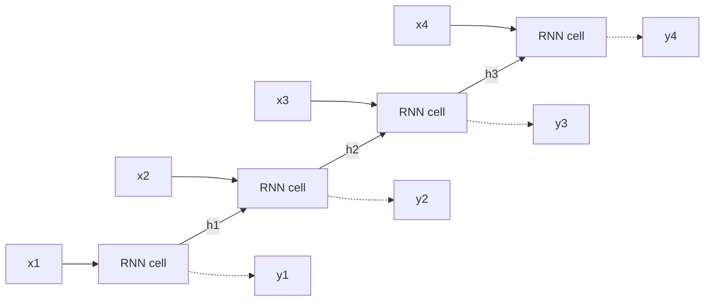

**In simple words:** an RNN reads a sequence one step at a time and keeps a memory (the hidden state) of what it has read, so it can use earlier inputs while handling the current one.

**Definition:** an RNN is a type of neural network that has hidden states and allows past outputs to be used as inputs. <Cite id="class-dl-m5" loc="p. 9" />

**Why it is needed:** a feedforward network has no memory of previous inputs and needs separate parameters for each element of a sequence. An RNN uses the **same weights at every time step**, so it has fewer parameters and handles sequences of any length. <Cite id="class-dl-m5" loc="p. 7" /> <Cite id="class-dl-m5" loc="p. 8" />

**Working, step by step** <Cite id="class-dl-chp5" loc="slide 7" />

1. Take the current input $x_t$ and the previous hidden state $h_{t-1}$.
2. The cell combines them and gives the new hidden state $h_t = \tanh(U x_t + W h_{t-1} + b)$ and the output $\hat{y}_t = \text{softmax}(V h_t + c)$.
3. Repeat for every element of the sequence. $U, W, V, b, c$ are the same at every step.

**Types:** one to one, one to many (image captioning), many to one (sentiment analysis), many to many (machine translation). <Cite id="class-dl-m5" loc="p. 11" />

**Training:** backpropagation through time (BPTT): forward through time, then the error goes backward through time and the weights are updated. <Cite id="class-dl-chp5" loc="slide 10" />

**Limitations:** vanishing and exploding gradients, so long-term dependencies are hard to learn. <Cite id="class-dl-chp5" loc="slide 12" />

**Applications:** speech recognition, music generation, translation, video analysis, DNA sequences. <Cite id="class-dl-m5" loc="p. 15" />

**Conclusion:** RNN = sequential data + previous information + hidden state.
