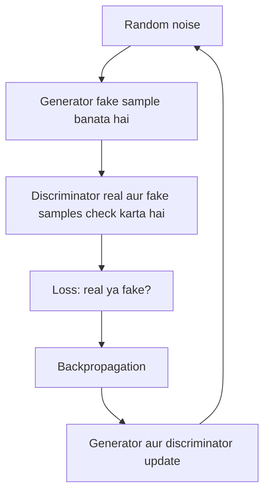

**In simple words:** GAN mein do networks compete karte hain. Generator random noise se fake data banata hai aur discriminator fake ko real se alag pehchaanne ki koshish karta hai. Dono behtar hote jaate hain, jab tak generator realistic data na banane lage. <Cite id="class-dl-chp6" loc="slide 6" />

**Definition:** Generative Adversarial Network (GAN) ek deep learning model hai jo real training data jaisa dikhne wala naya data generate karta hai. <Cite id="class-dl-chp6" loc="slide 3" />

**Do networks:** **generator (G)** random noise leta hai aur fake sample banata hai; **discriminator (D)** real aur fake samples dekhta hai aur predict karta hai ki har ek real hai ya fake. <Cite id="class-dl-chp6" loc="slide 3" />

**Training steps:**

1. Generator ko random noise milta hai aur wo fake sample banata hai.
2. Real aur fake samples discriminator ko diye jaate hain.
3. Loss nikalta hai: discriminator galti kare to loss badhta hai; sahi ho to loss low.
4. Backpropagation se dono networks apne parameters update karte hain.
5. Process kai iterations tak repeat hota hai jab tak generator realistic samples na banaye. <Cite id="class-dl-chp6" loc="slide 2" />

**Example:** hazaaron human face images par GAN train karo. Shuru mein generated face poor hota hai aur discriminator aasani se "fake" kehta hai. Feedback se faces better, even better aur aakhir mein realistic ho jaate hain, isliye GAN aise naye faces generate karta hai jo training data mein the hi nahi. <Cite id="class-dl-chp6" loc="slide 11" />

**Training ke baad** sirf trained generator use hota hai: naya random noise andar jaata hai aur naya image nikalta hai. <Cite id="class-dl-chp6" loc="slide 11" />

**Conclusion:** GAN real data se patterns seekhta hai aur generator se naye samples banata hai, jabki discriminator real ya fake check karke unki quality improve karta hai. <Cite id="class-dl-chp6" loc="slide 2" />
