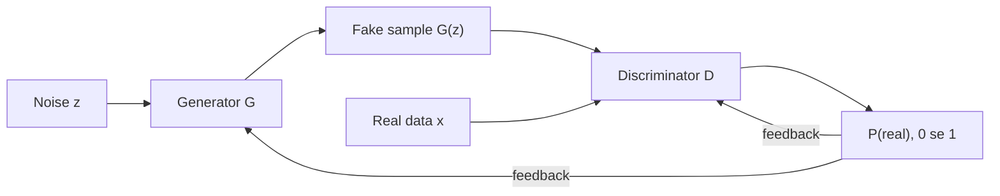

**In simple words:** Generative Adversarial Network (GAN) do neural networks ka game hai. **Generator** random noise se fake data banata hai, aur **discriminator** pehchanne ki koshish karta hai ki data fake hai ya real. Dono ek doosre ko haraane ki koshish mein behtar hote hain, jab tak fake bhi real lagne lagte hain.

**Definition.** GAN (Goodfellow et al., 2014 <Cite id="goodfellow2014" />) ek generative model hai, jisme generator $G$ aur discriminator $D$ ek doosre ke against train hote hain. Ye aise hai jaise ek forger nakli note chhapta hai aur police unhe check karti hai: jaise jaise police better hoti hai, forger ko better fake banana padta hai. <Cite id="gfdl-ch20" />

**Why it is needed.** Hum aksar naya, realistic data chahte hain (chehre, images, extra training data). Kai purane generative models ko har image ki probability nikalni ya approximate karni padti thi, jo mushkil hai. GAN ye avoid karta hai: ek network samples banata hai, doosra unhe judge karta hai, aur labels ki zarurat nahi hoti.

**Parts**

1. **Noise $z$:** random numbers ki list, ek naye sample ka seed.
2. **Generator $G$:** $z$ ko ek fake sample $G(z)$ mein badalta hai, jaise image. Wo real data kabhi nahi dekhta; wo sirf D ke feedback se seekhta hai.
3. **Real data $x$:** bina label ke training examples.
4. **Discriminator $D$:** ek classifier jo batata hai ki input real hai, uski probability (0 se 1) ke roop mein.

**Working (training steps)**

1. Real data ka ek batch lo (label 1) aur noise se fakes ka batch banao (label 0).
2. **D ko train karo** jab G frozen ho, taaki wo real data ko high score aur fakes ko low score de.
3. Naye fakes banao aur **G ko train karo** jab D frozen ho. Error D ke through G tak wapas jaata hai, to G aisa badalta hai ki D uske fakes ko "real" bole.
4. Repeat karo. G D ko dhoka dene mein behtar hota hai, aur D G ko pakadne mein.

**The game in one line.** D is score ko high rakhna chahta hai (real data ko "real", fakes ko "fake" bolkar); G dhoka dekar ise low karna chahta hai:

$$
\min_G \max_D \; \mathbb{E}_{x}[\ln D(x)] + \mathbb{E}_{z}[\ln(1 - D(G(z)))]
$$

Yahan $\mathbb{E}$ samples par average hai, $\ln$ natural log hai, $D(x)$ real sample $x$ par D ka score hai, aur $G(z)$ ek fake sample hai. D chahta hai ki ye value high ho; G chahta hai ki low ho.

**End point.** Ideally fakes real data jaise ho jaate hain, to D sirf andaza laga sakta hai aur har sample par $0.5$ deta hai. Tab D ko hata dete hain, aur G naye noise se naye samples banata hai. <Cite id="google-gan-training" />

**Advantages and limitations.** GAN bina labels ke sharp, realistic samples deta hai. Lekin training unstable hoti hai, aur generator sirf kuch hi tarah ke output bana sakta hai (mode collapse).

**Applications.** Realistic chehre banana, image-to-image translation, super-resolution, data augmentation aur deepfakes. <Cite id="gfg-gan" />

**Conclusion:** GAN bina labels ke realistic data generate karna seekhta hai, jisme generator aur discriminator baari-baari se ek doosre ke against train hote hain.

Exam mein English mein likho: "A GAN learns to generate realistic data without labels by training a generator and a discriminator against each other in turns."
