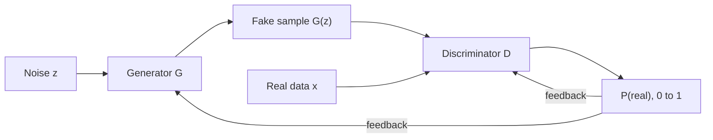

**In simple words:** a Generative Adversarial Network (GAN) is two neural networks playing a game. The **generator** makes fake data from random noise, and the **discriminator** tries to tell fake data from real data. Each improves by trying to beat the other, until the fakes look real.

**Definition.** A GAN (Goodfellow et al., 2014 <Cite id="goodfellow2014" />) is a generative model made of a generator $G$ and a discriminator $D$ trained against each other <Cite id="gfdl-ch20" />. It is like a forger printing fake notes and the police checking them: as the police get better, the forger must make better fakes.

**Why it is needed.** We often want new, realistic data (faces, images, extra training data). Many older generative models had to compute or approximate the probability of every image, which is hard. A GAN avoids this: one network makes samples, the other judges them, and no labels are needed.

**Parts**

1. **Noise $z$:** a list of random numbers, the seed for one new sample.
2. **Generator $G$:** turns $z$ into a fake sample $G(z)$, such as an image. It never sees real data; it learns only from D's feedback.
3. **Real data $x$:** unlabelled training examples.
4. **Discriminator $D$:** a classifier that outputs the probability (0 to 1) that its input is real.

**Working (training steps)**

1. Take a batch of real data (label 1) and make a batch of fakes from noise (label 0).
2. **Train D** with G frozen, so it gives real data high scores and fakes low scores.
3. Make new fakes and **train G** with D frozen. The error flows back through D into G, so G changes to make D call its fakes "real".
4. Repeat. G gets better at fooling D, and D gets better at catching G.

**The game in one line.** D tries to make the score below high (say "real" to real data and "fake" to fakes); G tries to make it low by fooling D:

$$
\min_G \max_D \; \mathbb{E}_{x}[\ln D(x)] + \mathbb{E}_{z}[\ln(1 - D(G(z)))]
$$

Here $\mathbb{E}$ is the average over samples, $\ln$ is the natural log, $D(x)$ is D's score for a real sample $x$, and $G(z)$ is a fake sample. D wants this value high; G wants it low.

**End point.** Ideally the fakes match the real data, so D can only guess and outputs $0.5$ for every sample. D is then thrown away, and G makes new samples from new noise. <Cite id="google-gan-training" />

**Advantages and limitations.** GANs give sharp, realistic samples without labels. But training is unstable, and the generator may produce only a few kinds of output (mode collapse).

**Applications.** Generating realistic faces, image-to-image translation, super-resolution, data augmentation and deepfakes. <Cite id="gfg-gan" />

**Conclusion:** a GAN learns to generate realistic data without labels by training a generator and a discriminator against each other in turns.
