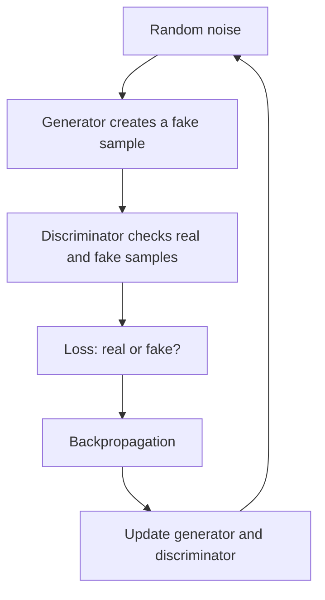

**In simple words:** a GAN has two networks that compete. The generator makes fake data from random noise and the discriminator tries to tell fake from real. Both get better, until the generator makes realistic data. <Cite id="class-dl-chp6" loc="slide 6" />

**Definition:** a Generative Adversarial Network (GAN) is a deep learning model used to generate new data that looks similar to real training data. <Cite id="class-dl-chp6" loc="slide 3" />

**Two networks:** the **generator (G)** takes random noise and creates a fake sample; the **discriminator (D)** looks at real and fake samples and predicts whether each is real or fake. <Cite id="class-dl-chp6" loc="slide 3" />

**Training steps:**

1. The generator receives random noise and creates a fake sample.
2. Real and fake samples are passed to the discriminator.
3. The loss is calculated: if the discriminator makes mistakes the loss increases; if it is correct the loss is low.
4. By backpropagation both networks update their parameters.
5. The process repeats for many iterations until the generator produces realistic samples. <Cite id="class-dl-chp6" loc="slide 2" />

**Example:** train a GAN on thousands of human face images. At first the generated face is poor and the discriminator easily says "fake". With feedback the faces become better, even better and finally realistic, so the GAN generates new faces that were not in the training data. <Cite id="class-dl-chp6" loc="slide 11" />

**After training** only the trained generator is used: new random noise goes in and a new image comes out. <Cite id="class-dl-chp6" loc="slide 11" />

**Conclusion:** a GAN learns patterns from real data and uses the generator to create new samples, while the discriminator improves their quality by checking whether they are real or fake. <Cite id="class-dl-chp6" loc="slide 2" />
