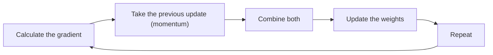

**In simple words:** SGD har ek sample ke baad weights update karta hai, jo fast hai par zig-zag karta hai; momentum pichle step ki memory add karta hai, to path smooth aur tez ho jaata hai. <Cite id="class-dl-chp2" loc="slides 68 and 74" />

**Stochastic gradient descent (SGD).** Ye ek optimization algorithm hai jo poore dataset ka intezaar karne ke bajaye ek samay mein sirf ek training sample process karke model ke weights update karta hai. Steps: ek sample pick karo, forward propagation, loss, backpropagation, weights turant update, agle sample ke liye repeat. Formula: $W_{new} = W_{old} - \eta \dfrac{\partial L_i}{\partial W}$, jahan $L_i$ ek sample ka loss hai. <Cite id="class-dl-chp2" loc="slides 68 and 69" /> **Advantages:** batch GD se faster, kam memory, bade datasets ke liye suitable, noisy updates local minima se nikal sakte hain. **Disadvantages:** zig-zag path, fluctuating loss, learning rate ke prati sensitive. <Cite id="class-dl-chp2" loc="slide 70" />

**Momentum gradient descent.** Ye pichle weight update ko yaad rakhkar gradient descent improve karta hai. Sirf current gradient par rely karne ke bajaye wo pichli direction bhi use karta hai, to optimizer sahi direction mein tez chalta hai aur kam zig-zag karta hai (dhakeli hui shopping cart jo apni speed banaye rakhti hai). <Cite id="class-dl-chp2" loc="slide 74" /> Velocity update: $V_t = \beta V_{t-1} - \eta \dfrac{\partial L}{\partial W}$. Weight update: $W_{new} = W_{old} + V_t$, jahan $\beta$ (usually 0.9) momentum coefficient hai. <Cite id="class-dl-chp2" loc="slide 75" />

**Momentum ke advantages:** faster convergence, smooth updates, kam oscillation, flat regions se nikalne mein help. **Disadvantages:** extra parameter $\beta$, momentum zyada ho to minimum overshoot ho sakta hai. <Cite id="class-dl-chp2" loc="slide 76" />

| | SGD | Momentum GD |
|---|---|---|
| Uses | Ek sample ka current gradient | Current gradient + previous update |
| Path | Zig-zag | Smoother |
| Pichle step ki memory | No | Yes |

**Conclusion:** momentum previous update ki direction mein speed jodkar SGD ka zig-zag theek karta hai.

Exam mein English mein likho: "Momentum improves gradient descent by remembering the previous weight update."
