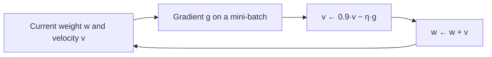

**In simple words:** dono loss par neeche (downhill) chalne ke tarike hain. SGD ek random example se chhote, tez steps leta hai. Momentum ek "velocity" jodta hai, taaki steps ek seedhi direction mein speed pakdein aur zig-zag ruk jaaye.

**1. Stochastic gradient descent (SGD)**

*Definition:* SGD weights ko ek randomly chune hue training example ko dekh kar update karta hai, poore dataset ke baad nahi. <Cite id="gfdl-ch8" />

*Why needed:* plain (batch) gradient descent ek update se pehle saare $N$ examples process karta hai, jo bade datasets ke liye bahut slow hai.

*How it works:*

1. Training data ko shuffle karo.
2. Ek example lo, forward pass chalao aur uska loss nikaalo.
3. Us example ka gradient nikaalne ke liye backpropagation <Cite id="rumelhart1986" /> use karo.
4. Har weight update karo: naya weight = purana weight − learning rate × gradient.
5. Agle example par jao; kai epochs tak repeat karo, aur aksar time ke saath learning rate kam karte hain.

*Advantages:* bahut sasta step (har epoch mein $N$ updates, 1 ki jagah); learning turant shuru; streaming data par chalta hai; noise shallow bad spots se nikalne mein madad kar sakta hai.
*Disadvantages:* ek example se gradient noisy hota hai, to loss uchhalta hai aur minimum ke paas weights hilte rehte hain; GPUs ka achha use nahi hota. Practice mein chhota mini-batch use hota hai, aur libraries ise bhi SGD hi kehti hain.

**2. Momentum-based gradient descent**

*Definition:* memory wala gradient descent. Har step naye gradient ko pichle step ke saath jodta hai, jise **velocity** kehte hain.

*Why needed:* plain gradient descent tang valleys mein zig-zag karta hai aur halki slopes par bahut dheere chalta hai. <Cite id="hinton-lec6" />

*Analogy:* ek ball downhill ludhakti hai, aur har bump par ruk nahi jaati; wo apni speed rakhti hai.

*How it works:* purani velocity ka lagbhag 90 percent rakho, naya downhill push jodo, aur weight ko velocity se move karo: $v \leftarrow \alpha v - \eta\,\nabla L(w)$, $w \leftarrow w + v$, jahan momentum coefficient $\alpha \approx 0.9$ hai aur $\eta$ learning rate hai. Ek hi direction ke pushes jud kar speed badhate hain; jo pushes sign badalte hain wo cancel ho jaate hain (kam zig-zag). <Cite id="d2l-momentum" />

*Advantages:* tez convergence, oscillation damp hoti hai, chhote bumps aur flat areas se guzar jaata hai.
*Disadvantages:* minimum se aage nikal sakta hai (overshoot); ek aur setting tune karni padti hai.

**Applications:** online learning aur bahut bade datasets ke liye SGD; SGD with momentum CNNs train karne ka standard optimizer hai. <Cite id="gfg-sgd" /> <Cite id="gfg-momentum" />

| Point | SGD | Momentum GD |
|---|---|---|
| Step based on | Sirf current gradient | Current gradient + pichli velocity |
| Path | Noisy, zig-zag | Smooth, tez |
| Extra setting | Koi nahi | Momentum coefficient (0.9) |
| Risk | Minimum ke paas wobble | Overshoot, phir settle |

**Conclusion:** SGD training ko tez aur sasta banata hai; momentum har step ko smart banata hai. Inhe aam taur par saath use karte hain, "SGD with momentum" ke naam se.

Exam mein English mein likho: "SGD updates the weights after one example; momentum adds a velocity so that steps build up speed in a steady direction."
