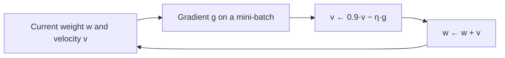

**In simple words:** both are ways of walking downhill on the loss. SGD takes quick steps using one random example at a time. Momentum adds a "velocity" so that steps build up speed in a steady direction and stop zig-zagging.

**1. Stochastic gradient descent (SGD)**

*Definition:* SGD updates the weights after looking at **one randomly chosen training example**, instead of the whole dataset. <Cite id="gfdl-ch8" />

*Why needed:* plain (batch) gradient descent must process all $N$ examples before a single update, which is very slow for large datasets.

*How it works:*

1. Shuffle the training data.
2. Take one example, run the forward pass and find its loss.
3. Use backpropagation <Cite id="rumelhart1986" /> to get the gradient for that example.
4. Update every weight: new weight = old weight − learning rate × gradient.
5. Move to the next example; repeat for many epochs, usually lowering the learning rate over time.

*Advantages:* very cheap steps ($N$ updates per epoch instead of 1); learning starts immediately; works on streaming data; the noise can help escape shallow bad spots.
*Disadvantages:* one example gives a noisy gradient, so the loss jumps around and the weights wobble near the minimum; poor use of GPUs. In practice a small mini-batch is used, and libraries still call it SGD.

**2. Momentum-based gradient descent**

*Definition:* gradient descent with memory. Each step combines the new gradient with the previous step, called the **velocity**.

*Why needed:* plain gradient descent zig-zags across narrow valleys and crawls on gentle slopes. <Cite id="hinton-lec6" />

*Analogy:* a ball rolling downhill keeps its speed instead of stopping at every bump.

*How it works:* keep about 90 per cent of the old velocity, add the new downhill push, and move the weight by the velocity: $v \leftarrow \alpha v - \eta\,\nabla L(w)$, $w \leftarrow w + v$, with momentum coefficient $\alpha \approx 0.9$ and learning rate $\eta$. Pushes in a steady direction add up (faster); pushes that flip sign cancel (less zig-zag). <Cite id="d2l-momentum" />

*Advantages:* faster convergence, damped oscillation, rolls through small bumps and flat regions.
*Disadvantages:* can overshoot the minimum; one more setting to tune.

**Applications:** SGD for online learning and huge datasets; SGD with momentum is a standard optimizer for training CNNs. <Cite id="gfg-sgd" /> <Cite id="gfg-momentum" />

| Point | SGD | Momentum GD |
|---|---|---|
| Step based on | Current gradient only | Current gradient + past velocity |
| Path | Noisy, zig-zag | Smoother, faster |
| Extra setting | None | Momentum coefficient (0.9) |
| Risk | Wobbles near minimum | Overshoots, then settles |

**Conclusion:** SGD makes training fast and cheap; momentum makes each step smarter. They are normally used together as "SGD with momentum".
