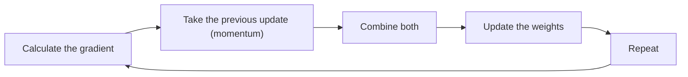

**In simple words:** SGD updates the weights after every single sample, which is fast but zig-zags; momentum adds the memory of the previous step, so the path becomes smoother and faster. <Cite id="class-dl-chp2" loc="slides 68 and 74" />

**Stochastic gradient descent (SGD).** It is an optimization algorithm that updates the model's weights after processing only one training sample at a time, instead of waiting for the entire dataset. Steps: pick one sample, forward propagation, loss, backpropagation, update the weights immediately, repeat for the next sample. Formula: $W_{new} = W_{old} - \eta \dfrac{\partial L_i}{\partial W}$, where $L_i$ is the loss of one sample. <Cite id="class-dl-chp2" loc="slides 68 and 69" /> **Advantages:** faster than batch GD, low memory, suits large datasets, noisy updates can escape local minima. **Disadvantages:** zig-zag path, fluctuating loss, sensitive to the learning rate. <Cite id="class-dl-chp2" loc="slide 70" />

**Momentum gradient descent.** It improves gradient descent by remembering the previous weight update. Instead of relying only on the current gradient, it also uses the previous direction, so the optimizer moves faster in the correct direction and zig-zags less (like a pushed shopping cart that keeps its speed). <Cite id="class-dl-chp2" loc="slide 74" /> Velocity update: $V_t = \beta V_{t-1} - \eta \dfrac{\partial L}{\partial W}$. Weight update: $W_{new} = W_{old} + V_t$, with $\beta$ (usually 0.9) the momentum coefficient. <Cite id="class-dl-chp2" loc="slide 75" />

**Advantages of momentum:** faster convergence, smooth updates, less oscillation, helps through flat regions. **Disadvantages:** extra parameter $\beta$, may overshoot the minimum if momentum is too high. <Cite id="class-dl-chp2" loc="slide 76" />

| | SGD | Momentum GD |
|---|---|---|
| Uses | Current gradient of one sample | Current gradient + previous update |
| Path | Zig-zag | Smoother |
| Memory of the previous step | No | Yes |

**Conclusion:** momentum fixes the zig-zag of SGD by adding speed in the direction of the previous update.
