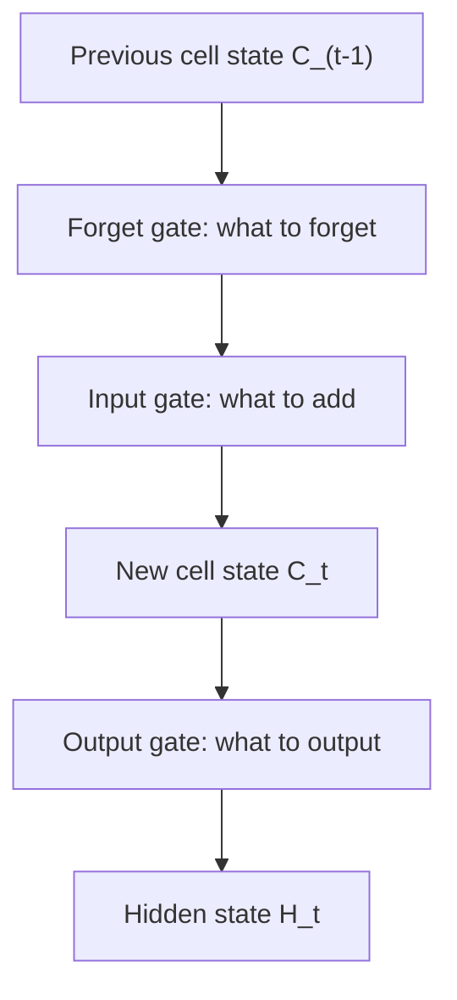

**In simple words:** LSTM ek RNN cell hai jisme long-term memory (cell state) hoti hai aur teen gates jo tay karte hain ki kya forget karna hai, kya store karna hai aur kya dikhana hai.

**Definition:** LSTM ek special kind ka recurrent neural network hai jo long-term dependencies handle kar sakta hai. Ye ek advanced RNN hai jo information ko persist hone deta hai aur RNN ki vanishing gradient problem handle kar sakta hai. <Cite id="class-dl-m5" loc="p. 18" />

**Kyun zaroori:** plain RNN vanishing gradient ki wajah se long-term dependencies yaad nahi rakh paata; "I grew up in India ... I speak Hindi" mein "India" ko kai steps tak bachna padta hai. LSTMs isse bachne ke liye bane hain. <Cite id="class-dl-m5" loc="p. 18" />

**Architecture.** Do states hain: **hidden state** (short-term memory, $H_{t-1}$, $H_t$) aur **cell state** (long-term memory, $C_{t-1}$, $C_t$). Teen gates (sigmoid, values 0 se 1): <Cite id="class-dl-m5" loc="p. 20" /> <Cite id="class-dl-m5" loc="p. 21" />

1. **Forget gate** $f_t = \sigma(x_t U_f + H_{t-1} W_f)$: jo information ab useful nahi use hata deta hai.
2. **Input gate** $i_t = \sigma(x_t U_i + H_{t-1} W_i)$ aur new information $N_t = \tanh(x_t U_c + H_{t-1} W_c)$: useful nayi information jodta hai.
3. **Output gate** $o_t = \sigma(x_t U_o + H_{t-1} W_o)$: tay karta hai ki output mein kya dikhana hai.

Cell state: $C_t = f_t C_{t-1} + i_t N_t$. Hidden state: $H_t = o_t \tanh(C_t)$. $H_t$ par softmax prediction deta hai. <Cite id="class-dl-m5" loc="p. 24" /> <Cite id="class-dl-m5" loc="p. 25" />

**Example:** $f_t = 0.2$, $C_{t-1} = 10$, $i_t = 0.8$, $N_t = 5$ se $C_t = 2 + 4 = 6$. <Cite id="class-dl-chp5" loc="slide 17" />

**Advantages:** long-term dependencies aur vanishing gradients handle karta hai; BPTT se train hota hai. **Applications:** Siri, Google voice search, time series, text classification. <Cite id="class-dl-m5" loc="p. 31" />

**Conclusion:** cell state long-term memory carry karta hai; gates control karte hain ki kya andar aaye, kya rahe aur kya bahar jaaye.
