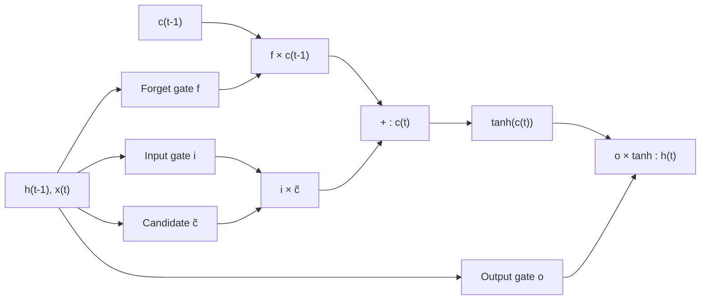

**In simple words:** LSTM (Long Short-Term Memory) ek improved RNN cell hai jo info ko bahut time steps tak yaad rakh sakta hai. Iske paas ek alag long-term memory hoti hai, jise cell state kehte hain, aur teen gates (0 se 1 ke beech numbers) decide karte hain ki kya bhoolna hai, kya naya likhna hai aur kya output dena hai.

**Why it is needed.** Simple RNN har step par poori memory dobara likhta hai, isliye uske gradients vanish ho jaate hain aur wo purani inputs bhool jaata hai. LSTM (Hochreiter aur Schmidhuber, 1997; forget gate 2000 mein add hua) memory ko copy aur add karke rakhta hai. <Cite id="hochreiter1997" /> <Cite id="gers2000" />

**Analogy.** Ek student jo chhote whiteboard par notes likhta hai: jo zaroori nahi use mitaata hai (**selective forget**), naye important points likhta hai (**selective write**), aur poochhne par sirf relevant hissa padhta hai (**selective read**).

**Components**

- **Cell state** $c_t$: long-term memory ki line. **Hidden state** $h_t$: is step ka output.
- **Forget gate** $f_t$: purani memory kitni rakhni hai.
- **Input gate** $i_t$: naya candidate $\tilde{c}_t$ (value $-1$ se $1$) kitna add karna hai.
- **Output gate** $o_t$: memory ka kitna hissa $h_t$ ke roop mein dikhana hai.

**How it works, step by step**

1. Pichla hidden state $h_{t-1}$ aur input $x_t$ jodo; har gate is par ek sigmoid layer hai.
2. Forget: purani cell state ko $f_t$ se multiply karo.
3. Write: $i_t$ guna candidate add karo. Isse nayi cell state banti hai.
4. Read: $h_t$ = $o_t$ guna tanh (nayi cell state).

**The memory update.** Har gate ek sigmoid layer hai jiske learned weights aur biases hain, to uska output 0 se 1 ke beech hota hai <Cite id="gfdl-ch10" loc="§10.10.1" /> <Cite id="d2l-lstm" />. Do lines poora idea carry karti hain. Yahan $\odot$ ka matlab hai matching numbers ko ek-ek karke multiply karna:

$$
c_t = f_t \odot c_{t-1} + i_t \odot \tilde{c}_t, \qquad h_t = o_t \odot \tanh(c_t)
$$

**Why it works.** Cell state ke raaste par gradient har step par sirf forget gate se multiply hota hai. Jab wo 1 ke paas rehta hai, gradient vanish nahi hota, aur LSTM lambe faasle ke links seekh leta hai. <Cite id="colah-lstm" />

**Advantages:** long-term memory, vanishing gradients mein bahut kami, separate gates se fine control.

**Disadvantages:** plain RNN se lagbhag 4 guna parameters, slow, aur exploding gradients ke liye phir bhi clipping chahiye.

**Applications:** machine translation, speech recognition, handwriting recognition, time-series forecasting. <Cite id="gfg-lstm" />

**Conclusion:** LSTM ek cell state use karta hai jiske saath forget, input aur output gates hain, jo long-term information yaad rakhte hain.

Exam mein English mein likho: "The LSTM uses a cell state with forget, input and output gates to remember long-term information."
