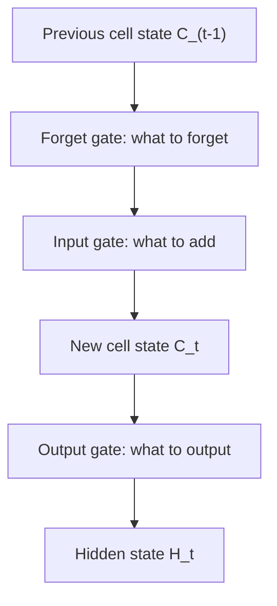

**In simple words:** an LSTM is an RNN cell with a long-term memory (the cell state) and three gates that decide what to forget, what to store and what to show.

**Definition:** LSTM is a special kind of recurrent neural network capable of handling long-term dependencies. It is an advanced RNN that allows information to persist and can handle the vanishing gradient problem of the RNN. <Cite id="class-dl-m5" loc="p. 18" />

**Why needed:** a plain RNN cannot remember long-term dependencies because of the vanishing gradient; "I grew up in India ... I speak Hindi" needs "India" to survive many steps. LSTMs are designed to avoid this. <Cite id="class-dl-m5" loc="p. 18" />

**Architecture.** There are two states: the **hidden state** (short-term memory, $H_{t-1}$, $H_t$) and the **cell state** (long-term memory, $C_{t-1}$, $C_t$). Three gates (sigmoid, values 0 to 1): <Cite id="class-dl-m5" loc="p. 20" /> <Cite id="class-dl-m5" loc="p. 21" />

1. **Forget gate** $f_t = \sigma(x_t U_f + H_{t-1} W_f)$: removes information no longer useful.
2. **Input gate** $i_t = \sigma(x_t U_i + H_{t-1} W_i)$ with new information $N_t = \tanh(x_t U_c + H_{t-1} W_c)$: adds useful new information.
3. **Output gate** $o_t = \sigma(x_t U_o + H_{t-1} W_o)$: decides what is shown as output.

Cell state: $C_t = f_t C_{t-1} + i_t N_t$. Hidden state: $H_t = o_t \tanh(C_t)$. Softmax on $H_t$ gives the prediction. <Cite id="class-dl-m5" loc="p. 24" /> <Cite id="class-dl-m5" loc="p. 25" />

**Example:** $f_t = 0.2$, $C_{t-1} = 10$, $i_t = 0.8$, $N_t = 5$ give $C_t = 2 + 4 = 6$. <Cite id="class-dl-chp5" loc="slide 17" />

**Advantages:** handles long-term dependencies and vanishing gradients; trained by BPTT. **Applications:** Siri, Google voice search, time series, text classification. <Cite id="class-dl-m5" loc="p. 31" />

**Conclusion:** the cell state carries long-term memory; the gates control what enters, stays and leaves.
