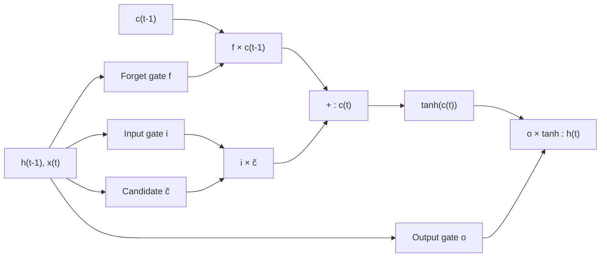

**In simple words:** an LSTM (Long Short-Term Memory) is an improved RNN cell that can remember information for many time steps. It keeps a separate long-term memory, the cell state, and uses three gates (numbers between 0 and 1) to decide what to forget, what new information to write in, and what to output.

**Why it is needed.** A plain RNN rewrites its whole memory at each step, so its gradients vanish and it forgets long-ago inputs. The LSTM (Hochreiter and Schmidhuber, 1997; forget gate added in 2000) keeps memory by copying and adding instead. <Cite id="hochreiter1997" /> <Cite id="gers2000" />

**Analogy.** A student keeping notes on a small whiteboard: erase what is not needed (**selective forget**), write down the important new points (**selective write**), and read out only the relevant part when asked (**selective read**).

**Components**

- **Cell state** $c_t$: the long-term memory line. **Hidden state** $h_t$: the output at this step.
- **Forget gate** $f_t$: how much old memory to keep.
- **Input gate** $i_t$: how much of the new candidate $\tilde{c}_t$ (values $-1$ to $1$) to add.
- **Output gate** $o_t$: how much memory to show as $h_t$.

**How it works, step by step**

1. Join the previous hidden state $h_{t-1}$ and the input $x_t$; each gate is a sigmoid layer on this.
2. Forget: multiply the old cell state by $f_t$.
3. Write: add $i_t$ times the candidate. This gives the new cell state.
4. Read: $h_t$ is $o_t$ times tanh of the new cell state.

**The memory update.** Each gate is a sigmoid layer with learned weights and biases, so its output is between 0 and 1 <Cite id="gfdl-ch10" loc="§10.10.1" /> <Cite id="d2l-lstm" />. Two lines carry the whole idea. Here $\odot$ means multiplying matching numbers one by one:

$$
c_t = f_t \odot c_{t-1} + i_t \odot \tilde{c}_t, \qquad h_t = o_t \odot \tanh(c_t)
$$

**Why it works.** Along the cell state the gradient is multiplied only by the forget gate at each step. When it stays near 1 the gradient does not vanish, so the LSTM learns long-range links. <Cite id="colah-lstm" />

**Advantages:** long-term memory, greatly reduced vanishing gradients, fine control through separate gates.

**Disadvantages:** about 4 times the parameters of a plain RNN, slower, and exploding gradients still need clipping.

**Applications:** machine translation, speech recognition, handwriting recognition, time-series forecasting. <Cite id="gfg-lstm" />

**Conclusion:** the LSTM uses a cell state with forget, input and output gates to remember long-term information.
