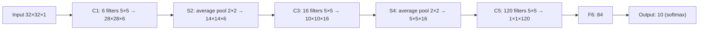

**In simple words:** LeNet-5 sabse pehle ke CNNs mein se ek hai. Ye handwritten digit ki chhoti grayscale picture padhta hai, convolution aur subsampling se edges aur shapes dhundta hai, aur fully connected layers se digit ka naam batata hai.

**Definition:** LeNet-5 ek CNN architecture hai jo handwritten digit recognition ke liye bana hai, jo convolution, subsampling/pooling aur fully connected layers use karke images se features khud seekhta hai aur unhe classify karta hai. Ise LeCun et al. (1998) ne banaya. <Cite id="class-dl-chp4" loc="slide 43" /> <Cite id="class-dl-m4" loc="p. 43" />

**Layers** <Cite id="class-dl-chp4" loc="slide 45" /> <Cite id="class-dl-m4" loc="p. 51" />

| Layer | Operation | Output | Job |
|---|---|---|---|
| Input | 32×32 grayscale image | 32×32×1 | Raw pixels |
| C1 | 6 filters 5×5, stride 1, tanh | 28×28×6 | Edges, lines, curves |
| S2 | Average pooling 2×2, stride 2 | 14×14×6 | Size kam, depth same |
| C3 | 16 filters 5×5, tanh | 10×10×16 | Shapes, corners |
| S4 | Average pooling 2×2, stride 2 | 5×5×16 | Phir size kam |
| C5 | 120 filters 5×5, tanh | 1×1×120 | High-level features |
| F6 | Fully connected, tanh | 84 | Features combine |
| Output | Fully connected + softmax | 10 | Digits 0 se 9 ki probability |

**"5" kyun?** Ismein paanch trainable layers hain (C1, C3, C5, F6, Output); pooling layers gini nahi jaati. Isme lagbhag 60 hazaar parameters hain. <Cite id="class-dl-chp4" loc="slide 43" />

**Important ideas:** convolution, subsampling/pooling, hierarchical feature learning (edges → curves → digit ke parts → poora digit), multiple feature maps. **Merits:** features khud seekhta hai aur fully connected network se kam parameters. **Demerits:** alag picture classes par kam scale hota hai, bade filters, sirf low-level features. <Cite id="class-dl-m4" loc="p. 85" />

**Conclusion:** LeNet-5 handwritten digit recognition ke liye ek early aur influential CNN hai; ise modern CNNs ka foundational architecture maana jaata hai. <Cite id="class-dl-chp4" loc="slide 43" />
