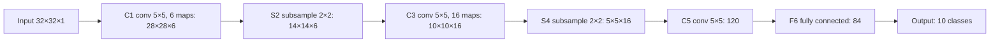

**In simple words:** LeNet-5 pehle wale convolutional neural networks mein se ek hai, jise Yann LeCun aur saathiyon ne 1998 mein handwritten digits padhne ke liye banaya tha. Ye convolution aur subsampling (pooling) ko do-do baar alternate karta hai, phir fully connected layers se classify karta hai. <Cite id="lecun1998" />

**Definition:** LeNet-5 ek 7-layer CNN hai (input ko chhod kar), jo 32×32 grayscale image leta hai aur 10 digits mein se ek output deta hai.

**Why it was needed:** purane digit readers hand-designed features use karte the, jo handwriting badalne par fail ho jaate the. LeNet features seedhe pixels se seekhta tha aur weight sharing se chhota rehta tha (lagbhag 60,000 parameters). Ise bank cheques padhne ke liye use kiya gaya.

**How it works, step by step**

1. **Input:** 32×32 grayscale image.
2. **C1 (convolution):** 5×5 ke 6 filters strokes aur edges dhoondhte hain → 28×28 ke 6 maps.
3. **S2 (subsampling):** 2×2 averaging-type pooling → 14×14×6.
4. **C3 (convolution):** 5×5 ke 16 filters strokes ko shapes mein jodte hain → 10×10×16. Har C3 map sirf kuch S2 maps dekhta hai, to connections kam hain aur maps alag features seekhte hain.
5. **S4 (subsampling):** → 5×5×16.
6. **C5 (convolution):** 5×5 ke 120 filters → 120 values.
7. **F6 (fully connected):** 84 units.
8. **Output:** 10 units, har digit ke liye ek. <Cite id="d2l-lenet" />

**Key features**

- **Trainable subsampling:** har S unit 4 inputs leta hai, ek learned coefficient se multiply karta hai aur bias jodta hai, jaise scaled average pooling.
- **Activation:** scaled tanh (modern versions ReLU aur max pooling use karte hain).
- **Output:** paper mein Euclidean RBF units the; zyaadatar textbooks 10-way softmax draw karti hain.
- **Size:** lagbhag 60,000 trainable parameters, jinme zyaadatar C5 (48,120) aur F6 (10,164) mein hain.
- **Result:** MNIST par 0.95% test error, aur distorted (augmented) training images ke saath 0.8%.

**Advantages:** chhota aur fast; apne features khud seekhta hai; weight sharing ise compact rakhta hai; digits par bahut accurate.

**Limitations:** chhoti grayscale images ke liye bana hai; bade colour photos aur bahut saare classes ke liye chhota hai; tanh slow train hota hai.

**Applications:** handwritten digit aur postal-code reading, bank cheque processing; aaj ye CNN ka standard teaching example hai. <Cite id="gfg-lenet" /> <Cite id="av-lenet" />

**Conclusion:** LeNet-5 ne conv → pool → conv → pool → fully connected ka pattern set kiya, jise AlexNet jaise baad ke CNNs ne follow kiya.

Exam mein English mein likho: "LeNet-5 set the pattern conv → pool → conv → pool → fully connected that later CNNs such as AlexNet followed."
