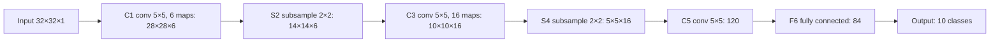

**In simple words:** LeNet-5 is one of the first convolutional neural networks, built by Yann LeCun and colleagues in 1998 to read handwritten digits. <Cite id="lecun1998" /> It alternates convolution and subsampling (pooling) twice and then classifies with fully connected layers.

**Definition:** LeNet-5 is a 7-layer CNN (not counting the input) that takes a 32×32 grayscale image and outputs one of 10 digits.

**Why it was needed:** older digit readers used hand-designed features that failed when handwriting changed. LeNet learned its features straight from the pixels and used weight sharing to stay small (about 60,000 parameters). It was used to read bank cheques.

**How it works, step by step**

1. **Input:** 32×32 grayscale image.
2. **C1 (convolution):** 6 filters of 5×5 find strokes and edges → 6 maps of 28×28.
3. **S2 (subsampling):** 2×2 averaging-type pooling → 14×14×6.
4. **C3 (convolution):** 16 filters of 5×5 combine strokes into shapes → 10×10×16. Each C3 map sees only some S2 maps, so there are fewer connections and maps learn different features.
5. **S4 (subsampling):** → 5×5×16.
6. **C5 (convolution):** 120 filters of 5×5 → 120 values.
7. **F6 (fully connected):** 84 units.
8. **Output:** 10 units, one per digit. <Cite id="d2l-lenet" />

**Key features**

- **Trainable subsampling:** each S unit adds 4 inputs, multiplies by a learned coefficient and adds a bias, like a scaled average pooling.
- **Activation:** scaled tanh (modern versions use ReLU and max pooling).
- **Output:** Euclidean RBF units in the paper; most textbooks draw a 10-way softmax.
- **Size:** about 60,000 trainable parameters, most of them in C5 (48,120) and F6 (10,164).
- **Result:** 0.95% test error on MNIST, 0.8% with distorted (augmented) training images.

**Advantages:** small and fast; learns its own features; weight sharing keeps it compact; very accurate on digits.

**Limitations:** built for small grayscale images; too small for large colour photos with many classes; tanh trains slowly.

**Applications:** handwritten digit and postal-code reading, bank cheque processing; today the standard teaching example of a CNN. <Cite id="gfg-lenet" /> <Cite id="av-lenet" />

**Conclusion:** LeNet-5 set the pattern conv → pool → conv → pool → fully connected that later CNNs such as AlexNet followed.
