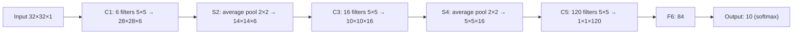

**In simple words:** LeNet-5 is one of the first CNNs. It reads a small grayscale picture of a handwritten digit, finds edges and shapes with convolution and subsampling, and names the digit with fully connected layers.

**Definition:** LeNet-5 is a CNN architecture designed for handwritten digit recognition, which uses convolution, subsampling/pooling and fully connected layers to automatically learn features from images and classify them. It was developed by LeCun et al. (1998). <Cite id="class-dl-chp4" loc="slide 43" /> <Cite id="class-dl-m4" loc="p. 43" />

**Layers** <Cite id="class-dl-chp4" loc="slide 45" /> <Cite id="class-dl-m4" loc="p. 51" />

| Layer | Operation | Output | Job |
|---|---|---|---|
| Input | 32×32 grayscale image | 32×32×1 | Raw pixels |
| C1 | 6 filters 5×5, stride 1, tanh | 28×28×6 | Edges, lines, curves |
| S2 | Average pooling 2×2, stride 2 | 14×14×6 | Reduce size, keep depth |
| C3 | 16 filters 5×5, tanh | 10×10×16 | Shapes, corners |
| S4 | Average pooling 2×2, stride 2 | 5×5×16 | Reduce size again |
| C5 | 120 filters 5×5, tanh | 1×1×120 | High-level features |
| F6 | Fully connected, tanh | 84 | Combine features |
| Output | Fully connected + softmax | 10 | Probability of digits 0 to 9 |

**Why "5"?** It has five trainable layers (C1, C3, C5, F6, Output); the pooling layers are not counted. It has about 60 thousand parameters. <Cite id="class-dl-chp4" loc="slide 43" />

**Important ideas:** convolution, subsampling/pooling, hierarchical feature learning (edges → curves → parts of digits → complete digit), multiple feature maps. **Merits:** learns features automatically and uses fewer parameters than a fully connected network. **Demerits:** poor scaling to various picture classes, large filters, low-level features only. <Cite id="class-dl-m4" loc="p. 85" />

**Conclusion:** LeNet-5 is an early and influential CNN for handwritten digit recognition; it is considered a foundational architecture of modern CNNs. <Cite id="class-dl-chp4" loc="slide 43" />
