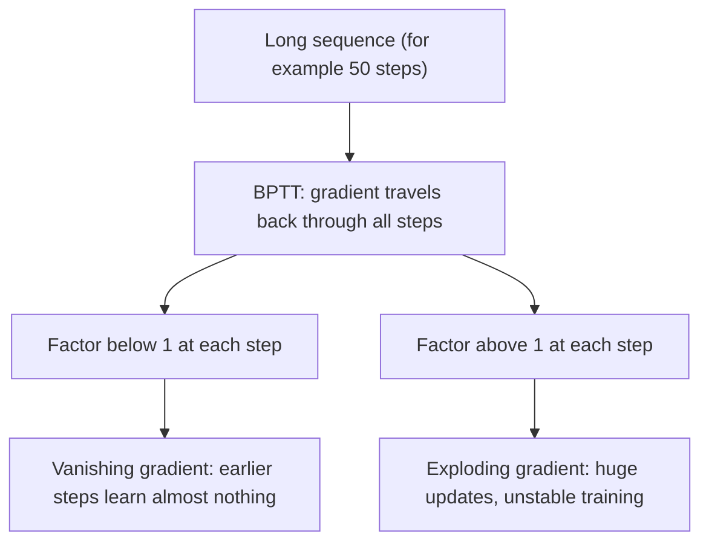

**In simple words:** jab RNN seekhta hai to error kai time steps peeche jaata hai aur baar-baar multiply hota hai. Agar multiplier chhota hai to error lagbhag khatam ho jaata hai (vanishing); agar bada hai to error phat jaata hai (exploding).

**Aisa kyun hota hai:** RNN backpropagation through time (BPTT) se train hota hai, isliye BPTT ke dauraan gradient ko kai time steps se guzarna padta hai. Guzarte hue wo bahut chhota ya bahut bada ho sakta hai. <Cite id="class-dl-chp5" loc="slide 10" />

**Vanishing gradient:** gradient values bahut chhoti ho jaati hain, isliye model seekhna band kar deta hai ya bahut zyada time leta hai. Peeche jaate hue wo chhota hota jaata hai, isliye pehle ke time steps ko bahut kam learning signal milta hai. Example: 1, 0.1, 0.01, 0.001, 0.0001. Result: RNN ko **long-term dependencies** seekhna mushkil. <Cite id="class-dl-m5" loc="p. 14" /> <Cite id="class-dl-chp5" loc="slide 11" />

**Exploding gradient:** gradient bahut bada ho jaata hai (1, 10, 100, 1000, 10000). Result: bahut bade weight updates, unstable training, seekhna mushkil. <Cite id="class-dl-chp5" loc="slide 11" />

**Fixes:** exploding gradients ko gradients truncate ya squash (clip) karke aasani se fix kar sakte hain, aur truncated BPTT backpropagation ko fixed number of steps tak limit karta hai. Vanishing gradients mushkil the; **LSTM** (aur GRU) ne gates se ye problem solve ki. <Cite id="class-dl-m5" loc="p. 14" /> <Cite id="class-dl-chp5" loc="slide 22" />

**Conclusion:** vanishing = too small, exploding = too large; dono kai time steps mein multiply hone se aate hain, aur dono vanilla RNN ko lambi sequences mein kamzor banate hain.
