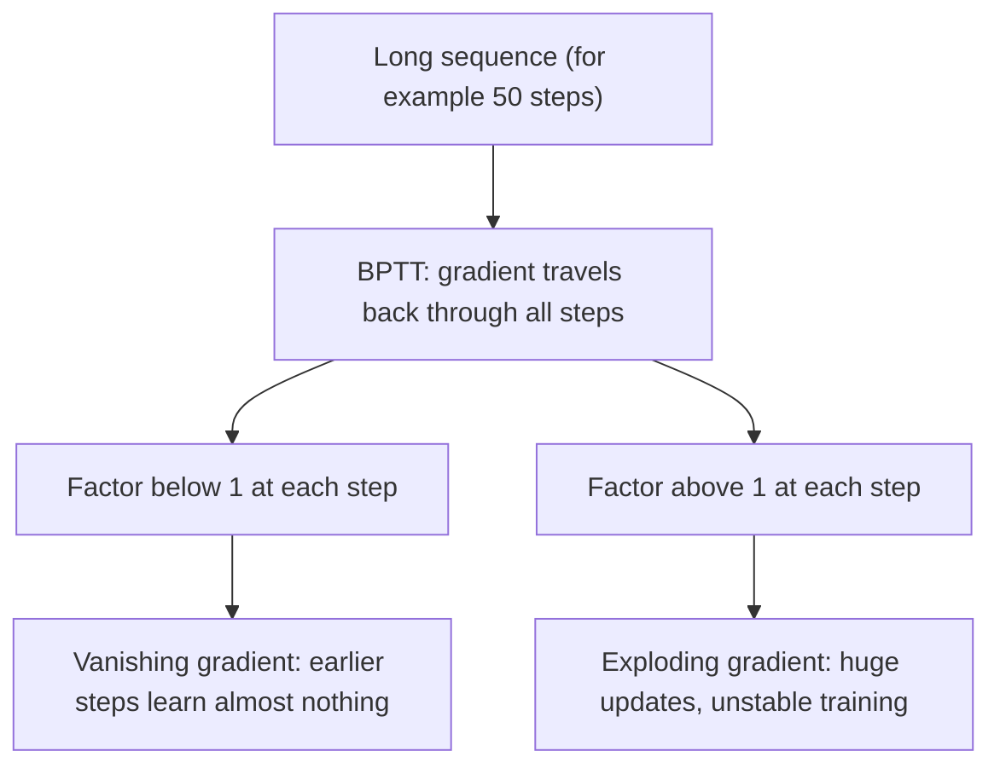

**In simple words:** when an RNN learns, the error travels back through many time steps and gets multiplied again and again. If the multiplier is small the error fades to almost nothing (vanishing); if it is big the error blows up (exploding).

**Why it happens:** an RNN is trained with backpropagation through time (BPTT), so during BPTT the gradient has to travel through many time steps. As it travels it can become very small or very large. <Cite id="class-dl-chp5" loc="slide 10" />

**Vanishing gradient:** the gradient values become too small, so the model stops learning or takes far too long. It gets smaller and smaller as it moves backward, so earlier time steps receive very little learning signal. Example: 1, 0.1, 0.01, 0.001, 0.0001. Result: the RNN has difficulty learning **long-term dependencies**. <Cite id="class-dl-m5" loc="p. 14" /> <Cite id="class-dl-chp5" loc="slide 11" />

**Exploding gradient:** the gradient becomes extremely large (1, 10, 100, 1000, 10000). Result: very large weight updates, unstable training, and learning becomes difficult. <Cite id="class-dl-chp5" loc="slide 11" />

**Fixes:** exploding gradients are easy to fix by truncating or squashing (clipping) the gradients, and truncated BPTT limits backpropagation to a fixed number of steps. Vanishing gradients were harder; the **LSTM** (and GRU) solved the problem with gates. <Cite id="class-dl-m5" loc="p. 14" /> <Cite id="class-dl-chp5" loc="slide 22" />

**Conclusion:** vanishing = too small, exploding = too large; both come from multiplying across many time steps, and both make a vanilla RNN weak on long sequences.
