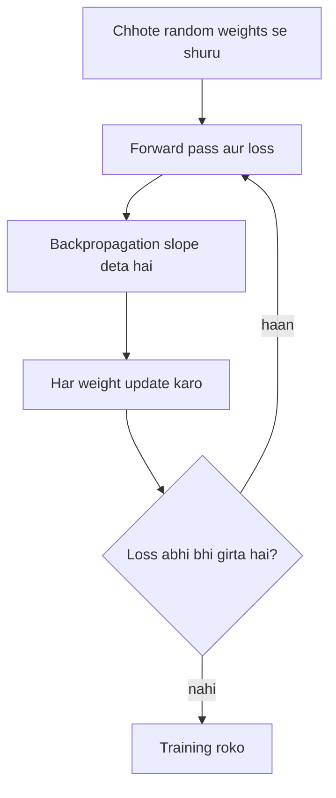

**In simple words:** gradient descent se neural network seekhta hai. Socho aap kohre wali pahadi se neeche utar rahe ho, hamesha sabse steep raasta lete hue. Network bhi apne weights ke saath yahi karta hai, aur loss ko thoda-thoda kam karta hai. <Cite id="gfdl-ch8" />

**Definition.** Gradient descent ek iterative method hai jo loss ko kam karta hai: har weight ko uski slope (gradient) ki ulti direction mein ek chhota step deke. Millions weights ki best value dene wala koi formula nahi hota, isliye backpropagation slopes deta hai aur gradient descent unhe use karta hai.

**Ye kaise kaam karta hai.**

1. Chhote random weights se shuru karo.
2. Forward pass: output aur loss nikalo.
3. Backpropagation: har weight ke liye loss ki slope nikalo.
4. Update: $w \leftarrow w - \eta\,\dfrac{\partial L}{\partial w}$, jahan $\eta$ **learning rate** (step size) hai. Bahut chhota ho to slow; bahut bada ho to overshoot karke diverge kar sakta hai.
5. Jab tak loss girna band na ho, repeat karo.

**Worked example.** Given: $w = 0.5$, slope $= 0.2$, $\eta = 0.1$. To find: naya weight.

1. Step size $= 0.1 \times 0.2 = 0.02$.
2. Slope ke ulta chalo: $0.5 - 0.02 = 0.48$.

**Answer: naya $w = 0.48$.**

<Box kind="verify">

Slope positive hai, matlab $w$ badhne se loss badhta hai; $w$ ko 0.48 tak neeche le jaane se loss kam hona chahiye. Arithmetic check: $0.48 + 0.02 = 0.50$, yani purana weight.

</Box>

**Types:** batch (har step mein saara data), stochastic (har step mein ek example), mini-batch (har step mein ek chhota group, sabse aam choice).

**Advantages:** simple hai, bahut bade networks tak scale hota hai. **Disadvantages:** learning rate chunna mushkil hai, aur ye local minima ya flat regions mein atak sakta hai.

**Conclusion.** Backpropagation slopes dhoondhta hai; gradient descent unka use karke network ko har step par thoda kam galat banata hai.

Exam mein English mein likho: "Gradient descent updates each weight by subtracting the learning rate times its gradient."
