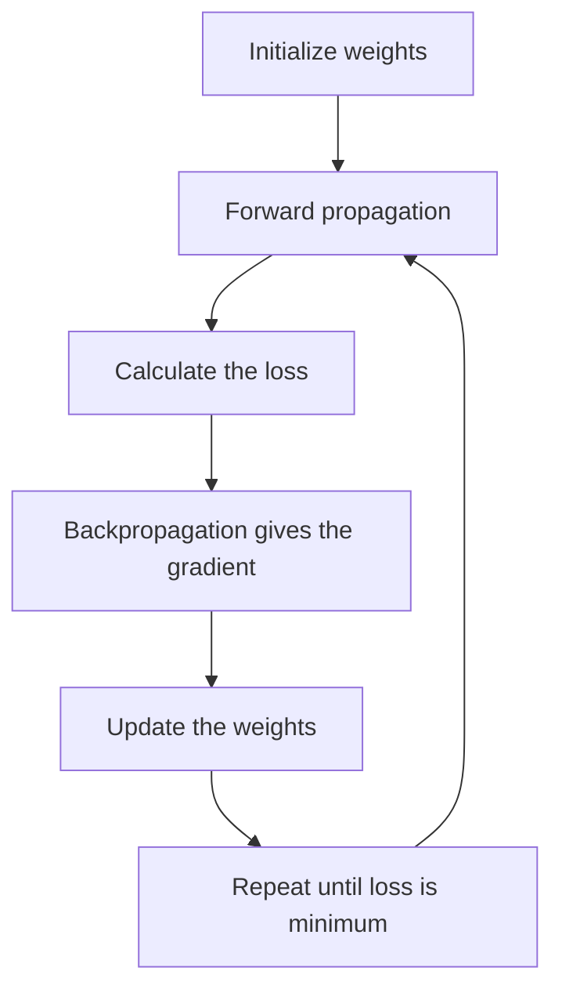

**In simple words:** gradient descent wo tareeka hai jisse network apna error kam karta hai: wo loss ka slope mehsoos karta hai aur baar-baar chhote steps neeche ki taraf leta hai. <Cite id="class-dl-chp2" loc="slide 63" />

**Definition:** Gradient Descent (GD) is an optimization algorithm that updates the weights and biases to reduce the loss. Its goal is to find the minimum loss by moving the weights in the correct direction. <Cite id="class-dl-chp2" loc="slide 60" />

**Ye kyun zaroori hai:** prediction ke baad network ko pata hai wo galat hai, par ye nahi pata ki kaun sa weight badalna hai, badhana hai ya ghatana hai, aur kitna. Loss sirf batata hai kitna error hai. <Cite id="class-dl-chp2" loc="slide 60" />

**Steps:** (1) loss ka gradient (slope) calculate karo, (2) wo direction dhundo jahan loss ghatta hai, (3) weights update karo, (4) loss bahut chhota hone tak repeat karo. <Cite id="class-dl-chp2" loc="slide 60" />

**Update rule:** $W_{new} = W_{old} - \eta \dfrac{\partial L}{\partial W}$, jahan $\eta$ learning rate hai aur $\dfrac{\partial L}{\partial W}$ gradient. Chhota $\eta$ slow learning, bada $\eta$ minimum skip kar sakta hai, proper $\eta$ fast aur stable learning deta hai. <Cite id="class-dl-chp2" loc="slide 63" />

**Types:** batch GD (sab samples), SGD (ek sample) aur mini-batch GD (chhota batch). **Limitation:** ye local minimum ya saddle point par ruk sakta hai. <Cite id="class-dl-m1" loc="p. 34" />

**Conclusion:** GD weights ko slope ke ulta baar-baar move karta hai jab tak loss jitna ho sake chhota na ho jaaye.

Exam mein English mein likho: "Gradient Descent is an optimization algorithm that updates the weights and biases to reduce the loss."
