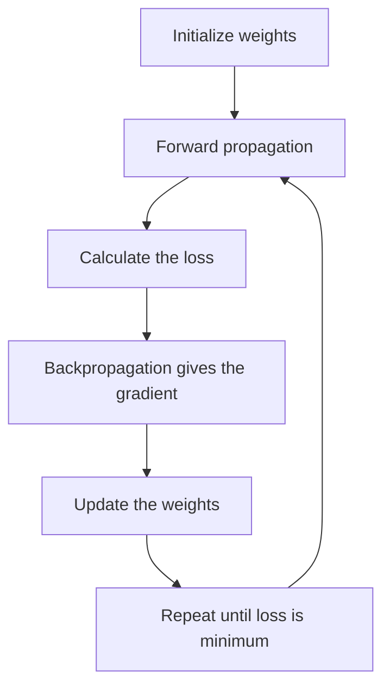

**In simple words:** gradient descent is how a network lowers its error: it feels the slope of the loss and takes small steps downhill, again and again. <Cite id="class-dl-chp2" loc="slide 63" />

**Definition:** Gradient Descent (GD) is an optimization algorithm that updates the weights and biases to reduce the loss. Its goal is to find the minimum loss by moving the weights in the correct direction. <Cite id="class-dl-chp2" loc="slide 60" />

**Why it is needed:** after a prediction the network knows it is wrong, but it does not know which weight to change, whether to increase or decrease it, and by how much. The loss only tells how much error exists. <Cite id="class-dl-chp2" loc="slide 60" />

**Steps:** (1) calculate the gradient (slope) of the loss, (2) find the direction where the loss decreases, (3) update the weights, (4) repeat until the loss is very small. <Cite id="class-dl-chp2" loc="slide 60" />

**Update rule:** $W_{new} = W_{old} - \eta \dfrac{\partial L}{\partial W}$, where $\eta$ is the learning rate and $\dfrac{\partial L}{\partial W}$ the gradient. Small $\eta$ gives slow learning, large $\eta$ may skip the minimum, a proper $\eta$ gives fast and stable learning. <Cite id="class-dl-chp2" loc="slide 63" />

**Types:** batch GD (all samples), SGD (one sample) and mini-batch GD (a small batch). **Limitation:** it may stop at a local minimum or a saddle point. <Cite id="class-dl-m1" loc="p. 34" />

**Conclusion:** GD repeatedly moves the weights against the slope until the loss is as small as possible.
