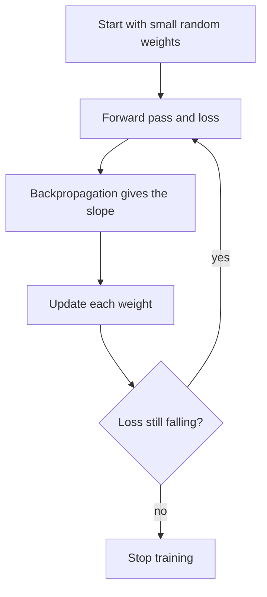

**In simple words:** gradient descent is how a neural network learns. Picture walking down a foggy hill, always stepping the steepest way down. The network does the same with its weights, lowering the loss a little at a time. <Cite id="gfdl-ch8" />

**Definition.** Gradient descent is an iterative method that lowers the loss by moving each weight a small step opposite to its slope (gradient). No formula gives the best values for millions of weights, so backpropagation supplies the slopes and gradient descent uses them.

**How it works.**

1. Start with small random weights.
2. Forward pass: compute the output and the loss.
3. Backpropagation: find the slope of the loss for every weight.
4. Update: $w \leftarrow w - \eta\,\dfrac{\partial L}{\partial w}$, where $\eta$ is the **learning rate** (step size). Too small is slow; too large overshoots and can diverge.
5. Repeat until the loss stops falling.

**Worked example.** Given: $w = 0.5$, slope $= 0.2$, $\eta = 0.1$. To find: the new weight.

1. Step size $= 0.1 \times 0.2 = 0.02$.
2. Move against the slope: $0.5 - 0.02 = 0.48$.

**Answer: new $w = 0.48$.**

<Box kind="verify">

The slope is positive, so raising $w$ raises the loss; moving $w$ down to 0.48 must lower it. Arithmetic check: $0.48 + 0.02 = 0.50$, the old weight.

</Box>

**Types:** batch (all data per step), stochastic (one example per step), mini-batch (a small group per step, the usual choice).

**Advantages:** simple, scales to very large networks. **Disadvantages:** learning rate is hard to choose, and it can stall in local minima or flat regions.

**Conclusion.** Backpropagation finds the slopes; gradient descent uses them to make the network less wrong at every step.
