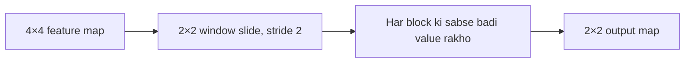

**In simple words:** pooling har feature map ko chhota karta hai: numbers ke ek chhote block ko ek summary number se badal kar, aam taur par sabse bada number (max pooling) ya average (average pooling). <Cite id="gfdl-ch9" />

**Ye kyun zaroori hai.** Convolution ke baad feature maps bade hote hain. Pooling inhe chhota karta hai, computation kam karta hai, aur network ko feature ki exact position ke prati kam sensitive banata hai.

**Ye kaise kaam karta hai.**

1. Ek window (aam taur par 2×2) aur ek stride (aam taur par 2, to windows overlap nahi karti) chuno.
2. Use har feature map par alag-alag slide karo aur har window se ek number rakho. Height aur width aadhe ho jaate hain; channels utne hi rehte hain.

**Types:** max pooling (sabse badi value), average pooling (mean), aur global average pooling (poore map ke liye ek number).

**Worked example.** Given: ek 2×2 block jiske values 1, 3, 5 aur 6 hain. To find: max pooling aur average pooling ka output.

1. Max pooling: sabse badi value lo, jo 6 hai, kyunki max pooling sabse strong signal rakhti hai.
2. Average pooling: values jodo, $1 + 3 + 5 + 6 = 15$, phir 4 values se bhaag do: $15 \div 4 = 3.75$.

**Answer: max pooling se 6; average pooling se 3.75.**

<Box kind="verify">

Average ko count se guna karke check karo: $3.75 \times 4 = 15$, block ka sum. Output size: $(4 - 2) \div 2 + 1 = 2$, to 4×4 map 2×2 ban jaata hai, jaisa diagram mein hai.

</Box>

**Advantages:** kam computation, chhote shifts ke prati robust, koi weights seekhne nahi padte. **Disadvantage:** ye detail aur exact positions kho deta hai. LeNet aur AlexNet jaise CNNs mein convolution aur ReLU ke baad use hota hai. <Cite id="gfg-cnn-pooling" />

**Conclusion.** Pooling strongest signals rakhta hai aur CNN ko chhota aur robust banata hai.

Exam mein English mein likho: "Max pooling keeps the largest value of each window and halves the height and width."
