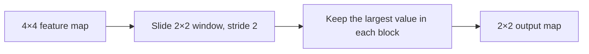

**In simple words:** pooling shrinks each feature map by replacing a small block of numbers with one summary number, usually the largest (max pooling) or the average (average pooling). <Cite id="gfdl-ch9" />

**Why it is needed.** Feature maps after convolution are large. Pooling shrinks them, cuts computation, and makes the network less sensitive to a feature's exact position.

**How it works.**

1. Choose a window (usually 2×2) and a stride (usually 2, so windows do not overlap).
2. Slide it over each feature map separately and keep one number per window. Height and width halve; channels stay the same.

**Types:** max pooling (largest value), average pooling (mean), and global average pooling (one number for the whole map).

**Worked example.** Given: one 2×2 block with the values 1, 3, 5 and 6. To find: the max pooling and average pooling outputs.

1. Max pooling: pick the largest value, which is 6, because max pooling keeps the strongest signal.
2. Average pooling: add the values, $1 + 3 + 5 + 6 = 15$, then divide by the count of 4 values: $15 \div 4 = 3.75$.

**Answer: max pooling gives 6; average pooling gives 3.75.**

<Box kind="verify">

Multiply the average back by the count: $3.75 \times 4 = 15$, the block's sum. Output size: $(4 - 2) \div 2 + 1 = 2$, so a 4×4 map becomes 2×2, as the diagram shows.

</Box>

**Advantages:** less computation, robust to small shifts, no weights to learn. **Disadvantage:** it throws away detail and exact positions. Used after convolution and ReLU in CNNs such as LeNet and AlexNet. <Cite id="gfg-cnn-pooling" />

**Conclusion.** Pooling keeps the strongest signals and makes the CNN smaller and more robust.
