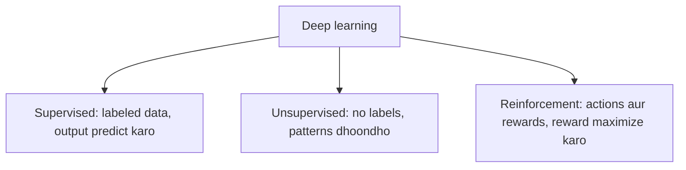

**In simple words:** deep learning models mainly teen types mein bante hain, is hisaab se ki wo data se kaise seekhte hain: supervised learning (answers ke saath), unsupervised learning (answers ke bina) aur reinforcement learning (experience se seekhna). <Cite id="class-dl-chp1" loc="slide 25" />

**1. Supervised learning.** Model **labeled data** se seekhta hai: input ke saath correct output aata hai, aur wo input (X) se output (Y) ka mapping seekhta hai. *Example:* cat ki photo dekar kaho "ye cat hai"; labeled cat aur dog images deep neural network se guzarti hain, jo label predict karta hai. *Use cases:* image classification, emails mein spam detection, handwriting recognition, object detection, medical diagnosis. *Networks:* CNN, RNN, LSTM. <Cite id="class-dl-chp1" loc="slide 25" /> <Cite id="class-dl-m1" loc="p. 36" />

**2. Unsupervised learning.** Model **bina labels** ke data se seekhta hai aur patterns ya groups khud dhoondhta hai. *Example:* bina naam ke bahut saari animal photos; model milte-julte animals ko group karta hai. *Use cases:* customer segmentation, similar products grouping, feature learning, dimensionality reduction, anomaly detection. *Networks:* autoencoders, deep belief networks, GANs. <Cite id="class-dl-chp1" loc="slide 25" /> <Cite id="class-dl-m1" loc="p. 36" />

**3. Reinforcement learning.** Model **actions karke aur rewards ya punishments pa kar** seekhta hai; wo time ke saath rewards maximize karne ki koshish karta hai. Agent state observe karta hai, action leta hai, reward receive karta hai aur policy update karta hai. *Example:* robot jo chalna seekh raha hai; wo koshish karta hai, girta hai aur feedback se seekhta hai. *Use cases:* game playing (chess, Go), robotics, self-driving cars. <Cite id="class-dl-chp1" loc="slide 25" /> <Cite id="class-dl-m1" loc="p. 36" />

| Type | Learns from | Needs labels? | Main goal |
|---|---|---|---|
| Supervised | Labeled data | Yes | Predict output |
| Unsupervised | Unlabeled data | No | Find patterns or groups |
| Reinforcement | Actions and feedback | No | Maximize rewards |

**Conclusion:** teen classes alag hain us data aur feedback ke type se jo learning mein use hota hai: supervised help ke saath seekhta hai, unsupervised khud dhoondhta hai, reinforcement karke seekhta hai. <Cite id="class-dl-m1" loc="p. 36" />
