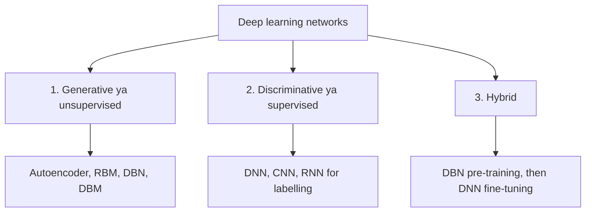

**In simple words:** Deng aur Yu deep networks ko unke kaam ke hisaab se teen classes mein baantte hain. Kuch networks bina labels ke data ke patterns seekhte hain (generative). Kuch labels predict karna seekhte hain (discriminative). Kuch dono ko mix karte hain, taaki bina label wala part label wale part ki help kare (hybrid). <Cite id="deng2012-three-classes" />

**Classify kyun karein?** Bahut saare deep architectures hain. Unhe kaam ke hisaab se group karne se pata chalta hai ki kis problem ke liye kaun si family chunein.

**1. Generative (unsupervised) networks**

- **Definition:** ye data ke main patterns seekhte hain jab **koi label nahi** diya gaya hota, taaki data analyse ho sake ya naya data ban sake. <Cite id="ibm-generative-model" />
- **Kaise kaam karte hain:** network apne hi input ko dobara banane ya copy karne ki koshish karta hai, aur is process mein uski hidden layers main patterns seekh leti hain.
- **Examples:** deep autoencoder, restricted Boltzmann machine (RBM), deep belief network (DBN), deep Boltzmann machine, aur baad mein GANs.
- **Pros aur cons:** sasta unlabelled data use karta hai aur samples generate kar sakta hai, lekin ise train karna aksar mushkil hota hai.
- **Uses:** feature learning, compression, denoising, images ya speech generate karna.

**2. Discriminative (supervised) networks**

- **Definition:** ye classes ko alag karna seekhte hain, yaani kisi input ka label predict karna. Inhe labels chahiye, kyunki label hi wo jawab hai jisse inka answer check hota hai.
- **Kaise kaam karte hain:** predict karo, loss se true label ke saath compare karo, aur backpropagation se weights theek karo.
- **Examples:** deep neural network (DNN), CNN, RNN jo label ka sequence deta hai, deep stacking network.
- **Pros aur cons:** accurate aur end-to-end hai, lekin bahut saare labels chahiye.
- **Uses:** image, speech aur handwriting recognition.

**3. Hybrid networks**

- **Definition:** goal discrimination hai, lekin ek generative network ke result se help milti hai.
- **Kaise kaam karta hai (DBN-DNN):** (1) DBN ko unlabelled data par layer by layer train karo; (2) uske weights ek DNN mein copy karo jiska shape same ho; (3) backpropagation se labels ke saath DNN ko fine-tune karo. <Cite id="hinton2006-dbn" />
- **Ye kyun help karta hai:** shuru ke achhe weights (pre-training) random weights se shuru karne ke muqabale learning aasan bana dete hain, aur data se seekhi hui structure ek rule ki tarah kaam karti hai jo overfitting kam karta hai.
- **Pros aur cons:** kam labels ke saath kaam karta hai, lekin do training stages chahiye.
- **Uses:** speech recognition, kam labelled scans wali medical imaging.

| | Generative | Discriminative | Hybrid |
|---|---|---|---|
| Labels | Not needed | Needed | Few, plus unlabelled data |
| Goal | Model or create data | Predict the label | Predict, helped by generative |
| Example | Autoencoder, DBN | CNN, DNN | DBN-DNN |

**Conclusion.** Generative networks data ko model karte hain, discriminative networks labels predict karte hain, aur hybrid networks pehle wale ka use karke doosre ko better train karte hain. Yahan "supervised" aur "unsupervised" shabd network ke kaam ko batate hain, poore machine-learning ke split ko nahi. <Cite id="gfg-supervised-unsupervised" />

Exam mein English mein likho: "Generative networks model the data, discriminative networks predict labels, and hybrid networks use the first to train the second better."
