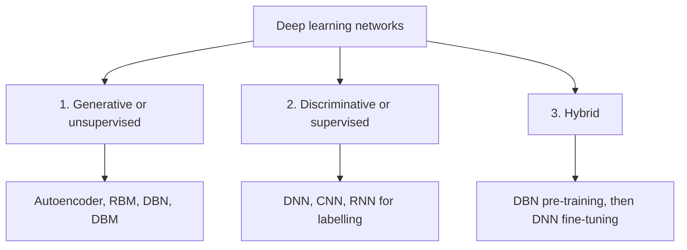

**In simple words:** Deng and Yu sort deep networks into three classes by their job. Some learn the patterns of the data without labels (generative). Some learn to predict labels (discriminative). Some mix the two, so the label-free part helps the label-based part (hybrid). <Cite id="deng2012-three-classes" />

**Why classify?** There are many deep architectures. Grouping them by job tells us which family to pick for a problem.

**1. Generative (unsupervised) networks**

- **Definition:** they learn the main patterns of the data when **no labels** are given, so they can analyse the data or create new data. <Cite id="ibm-generative-model" />
- **How it works:** the network tries to rebuild or imitate its own input, and its hidden layers learn the main patterns on the way.
- **Examples:** deep autoencoder, restricted Boltzmann machine (RBM), deep belief network (DBN), deep Boltzmann machine, and later GANs.
- **Pros and cons:** uses cheap unlabelled data and can generate samples, but it is often hard to train.
- **Uses:** feature learning, compression, denoising, generating images or speech.

**2. Discriminative (supervised) networks**

- **Definition:** they learn to separate classes, that is, to predict the label of an input. They need labels to learn, because the label is the answer they are checked against.
- **How it works:** predict, compare with the true label using a loss, and correct the weights by backpropagation.
- **Examples:** deep neural network (DNN), CNN, RNN that outputs a label sequence, deep stacking network.
- **Pros and cons:** accurate and end-to-end, but needs many labels.
- **Uses:** image, speech and handwriting recognition.

**3. Hybrid networks**

- **Definition:** the goal is discrimination, helped by the result of a generative network.
- **How it works (DBN-DNN):** (1) train a DBN layer by layer on unlabelled data; (2) copy its weights into a DNN of the same shape; (3) fine-tune the DNN with labels by backpropagation. <Cite id="hinton2006-dbn" />
- **Why it helps:** the good starting weights (pre-training) make learning easier than starting from random weights, and the structure learned from the data acts as a rule that reduces overfitting.
- **Pros and cons:** works with few labels, but needs two training stages.
- **Uses:** speech recognition, medical imaging with few labelled scans.

| | Generative | Discriminative | Hybrid |
|---|---|---|---|
| Labels | Not needed | Needed | Few, plus unlabelled data |
| Goal | Model or create data | Predict the label | Predict, helped by generative |
| Example | Autoencoder, DBN | CNN, DNN | DBN-DNN |

**Conclusion.** Generative networks model the data, discriminative networks predict labels, and hybrid networks use the first to train the second better. The words "supervised" and "unsupervised" here describe a network's purpose, not the whole machine-learning split. <Cite id="gfg-supervised-unsupervised" />
